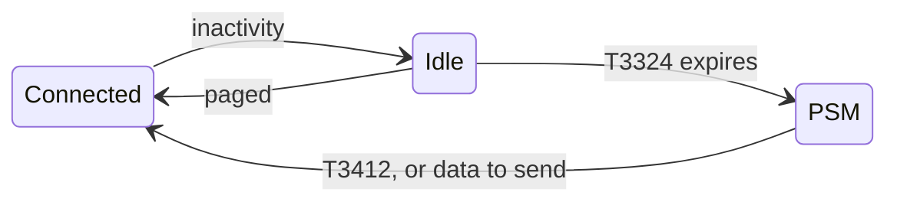
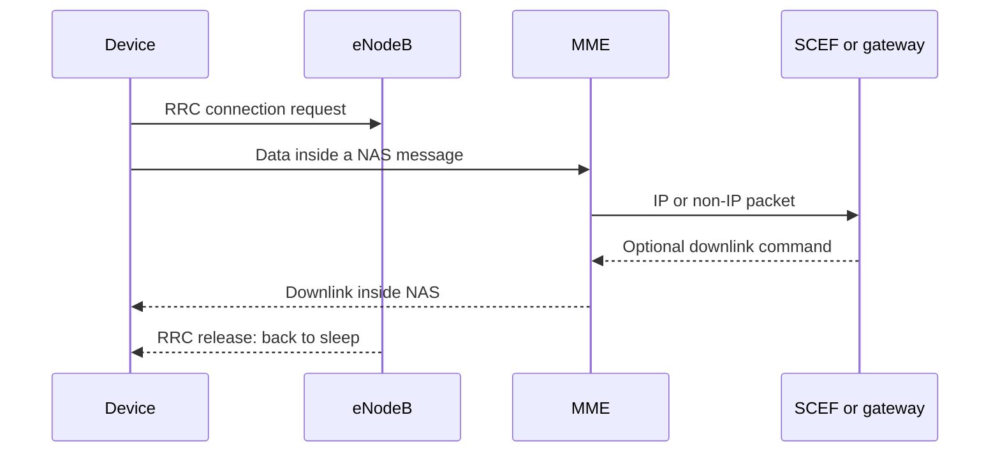

## Key figures {.stats style=tiles}

| Value | Label | Change | Verdict |
|---|---|---|---|
| 180 kHz | Carrier bandwidth: one LTE resource block | −87 % against LTE-M | good |
| 164 dB | Maximum coupling loss: the deepest indoor reach | +20 dB over GPRS | |
| 10 years and more | On a 5 Wh cell, sleeping in PSM | | |
| 50,000 | Devices a cell can serve | | |

## Introduction {.abstract}

**NB-IoT** is a 3GPP low-power wide-area cellular standard. It runs in licensed mobile spectrum beside LTE, reaches deep inside buildings and underground chambers, and lets a device sleep at microamps for days between messages. It suits meters and asset monitors that send a few hundred bytes a day.

## 1. Three ways to fit a 180 kHz carrier

Operators add NB-IoT to existing LTE base stations, usually by software:

```cards cols=1 style=top
Standalone | A 200 kHz channel taken back from GSM | navy
Guard band | In the unused edge of a wide LTE carrier, at no cost to LTE | blue
In band | One 180 kHz resource block inside a working LTE carrier | green
```

| Parameter | NB-IoT (Cat-NB1, Cat-NB2) |
|---|---|
| Duplex | Half-duplex FDD; TDD from Release 15 |
| Downlink | OFDMA, 15 kHz subcarriers |
| Uplink | SC-FDMA, single tone (3.75 or 15 kHz) or several |
| Peak rate | About 26 kbps (NB1); 127 kbps down, 159 kbps up (NB2) |
| Transmit power | 23 dBm, with 20 and 14 dBm classes |
| Latency | 1.6 to 10 s |

## 2. Repeat until it arrives

NB-IoT survives **164 dB** of coupling loss by repeating each transmission and combining the copies. The modem chooses a **coverage enhancement (CE) level**, CE0 to CE2, from the signal it measures.

```gradient-scale from=140 to=166 unit=" dB" colours=red,amber,green step=4
142 | LTE
144 | GPRS
156 | LTE-M
164 | NB-IoT
```

> [!NOTE]
> Repetition costs charge: a sensor in a deep basement, at CE2, can use fifty times the energy per message of one by a window.

NB-IoT repeats a downlink up to 2,048 times, and an uplink up to 128.

## 3. Asleep almost all day

Two 3GPP mechanisms keep the radio off for over 99 % of the time: **Power Saving Mode (PSM)** and **extended discontinuous reception (eDRX)**.



| Timer | What it sets | Longest |
|---|---|---|
| T3324, active time | How long the device stays reachable after sending, before PSM | 186 minutes |
| T3412, periodic TAU | How long it may sleep before a tracking-area update | 413 days |
| eDRX cycle | Time between paging checks while idle | 10,485.76 s: 2.9 hours |

## 4. A day of charge

```chart type=waterfall title="One report a day (mAs)" unit=" mAs" height=240
Send and receive, 3 s | +360 | amber | About 120 mA
Active time, 10 s | +30 | blue | 3 mA
PSM, the rest | +259 | navy | 3 µA for 24 hours
Each day | =649 | green | 0.18 mAh: 66 mAh a year
```

## 5. Small data without a bearer {cols=3}

Setting up a full LTE data bearer for a 50-byte reading wastes time and charge. **Control-plane CIoT optimisation** carries the data inside **NAS** signalling, through the MME:



```cards cols=1 style=label
Control plane | Data inside NAS messages, via the MME: least overhead for rare small packets
User plane | The radio context is suspended and resumed, so a session of several packets skips set-up
Non-IP data delivery | Raw frames through the SCEF, with no IP or UDP header at all
```

## 6. Bringing up a modem

```terminal title="Quectel BC660K, power-on to sleep"
> AT+QBAND=1,20
OK
> AT+CFUN=1
OK
> AT+CPSMS=1,,,"00111000","00000101"
OK
> AT+CEREG=4
> AT+CEREG?
+CEREG: 4,1,"2A10","01B4F02",9,,,"00000101","00111000"
-- Registered at home; the network granted T3324 = 10 s and T3412 = 24 h
```

What the two timer strings mean: three bits of unit, then five of value.

```syntax-anatomy
AT+CPSMS=1,,,"00111000","00000101"
001 | Unit: 1 hour | navy
11000 | ×24: T3412 = 24 h | blue
000 | Unit: 2 s | green
00101 | ×5: T3324 = 10 s | teal
```

> [!TIP]
> The network may grant other timers than you asked for. Read them back with `AT+CEREG=4` before working out battery life.

## 7. NB-IoT or LTE-M {style=card colour=blue}

```compare
| LTE-M (Cat-M1) | NB-IoT (Cat-NB2)
Bandwidth | 1.4 MHz | 180 kHz
Peak rate | About 1 Mbps | 127 kbps down, 159 up
Latency | 10 to 15 ms | 1.6 to 10 s
Moving | Full handover | Stationary
Voice | VoLTE | None
Coupling loss | 156 dB | **164 dB**
Modem cost | Moderate | **Lowest**
```

```checklist
[x] RSRP better than −115 dBm, at CE0 or CE1
[x] Granted PSM timers read back with AT+CEREG=4
[x] First uplink at the server within 10 seconds
[ ] Antenna clearance checked with the enclosure closed
```

## 8. Releases {.wide}

```timeline
2016 | Release 13 | NB-IoT (Cat-NB1): 180 kHz, PSM, eDRX, control-plane CIoT | navy
2017 | Release 14 | Cat-NB2: about 159 kbps, multicast, positioning, 14 dBm class | blue
2019 | Release 15 | Wake-up signal, early data transmission, TDD | green
2020 | Release 16 | Coexistence with 5G NR carriers and the 5G core | amber
2022 | Release 17 | Non-terrestrial networks: NB-IoT direct to satellite | red
```

## 9. Glossary {.wide}

```glossary cols=4
CE level | Coverage enhancement: how many repetitions
eDRX | Extended discontinuous reception
MCL | Maximum coupling loss
MME | Mobility management entity, in the core
NAS, RRC | Non-access stratum and radio resource control signalling
NIDD, SCEF | Non-IP data delivery, through the service capability exposure function
PSM | Power saving mode: radio off, registration kept
RSRP | Reference signal received power
```

## In short {.summary}

NB-IoT trades data rate for reach and battery life: small, reliable messages from basements and chambers for ten years.

### Deep indoor reach

Repetition adds 20 dB over GPRS, so buried sensors stay connected.

### Asleep almost all day

PSM and eDRX drop the current to microamps between reports.

### A managed network

Licensed operator spectrum, on LTE and 5G, with long-term support.

## References {.references}

1. 3GPP TS 36.211 and TS 36.331: E-UTRA physical channels and modulation; radio resource control.
2. 3GPP TS 24.301: Non-Access-Stratum protocol for EPS, including PSM, eDRX and control-plane CIoT.
