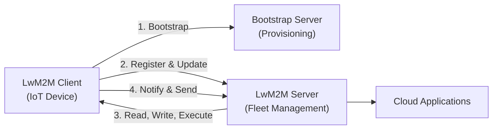
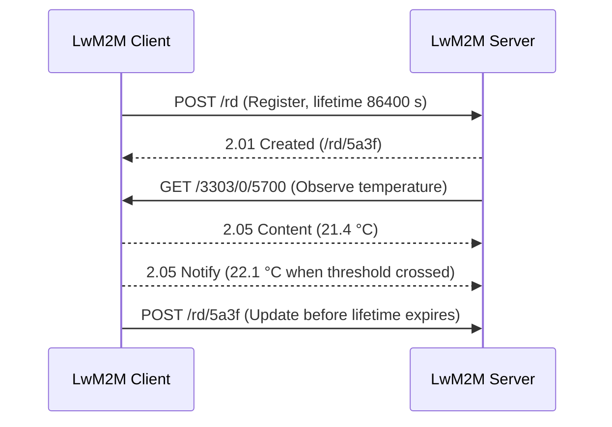

## Key figures {.stats style=tiles}

| Value | Label | Change | Verdict |
|---|---|---|---|
| 4 bytes | Constrained Application Protocol (CoAP) fixed header | -85 % vs HTTP | good |
| 5683 / 5684 | User Datagram Protocol (UDP) ports: plain and DTLS | 1-packet | good |
| 4 interfaces | Bootstrap, Registration, Management and Reporting | unified | good |
| 3 levels | Numeric Object / Instance / Resource tree (`/3303/0/5700`) | standard | good |

## Introduction {.abstract}

**Lightweight Machine-to-Machine (LwM2M)** is an open device management and telemetry protocol from the **Open Mobile Alliance (OMA)** for the **Internet of Things (IoT)**. Built on the **Constrained Application Protocol (CoAP)**, it fits microcontrollers with only a few kilobytes of **Random-Access Memory (RAM)**. It runs efficiently over low-power links such as **Narrowband Internet of Things (NB-IoT)**. Every device exposes the same numbered object tree, so one server can manage devices from any maker.

## 1. Architecture: three roles and a compact stack

LwM2M separates factory credential setup from daily device management across three roles:

```cards cols=3 style=top
LwM2M Client | Runs on the IoT device and exposes sensors, settings and firmware state as numbered objects | navy
Bootstrap Server | Provisions the device on first boot with its server addresses and cryptographic keys | blue
LwM2M Server | Reads telemetry, writes configuration, observes changes and triggers firmware updates | green
```



[[CAPTION:Figure]] The client requests credentials from the Bootstrap Server once, then registers with its LwM2M Server.

| Protocol layer | LwM2M 1.0 | Added in LwM2M 1.1 and 1.2 |
|---|---|---|
| Messaging | Constrained Application Protocol (CoAP) | CoAP over Transmission Control Protocol (TCP), MQTT and HTTP |
| Security | Datagram Transport Layer Security (DTLS) | Transport Layer Security (TLS) and object security |
| Transport | UDP and Short Message Service (SMS) | TCP, Non-IP Data Delivery (NIDD) and LoRaWAN |

## 2. Data model: every device is a numbered tree

Every resource on a device has a path of three numbers: `/Object/Instance/Resource`. Because the **Open Mobile Alliance (OMA)** and the **Internet Protocol for Smart Objects (IPSO)** registry assign these numbers globally, any server immediately understands `/3303/0/5700` without custom parsers.

```cards cols=3 style=label
Object 3303 | Category of feature: 3303 is the standard IPSO Temperature Sensor object
Instance 0 | Which sensor on the board: 0 is the first temperature sensor, 1 is the second
Resource 5700 | Single value or action: 5700 holds the current temperature reading
```

| Object ID | Standard object | What it holds |
|---|---|---|
| `0` | Security | Server Uniform Resource Identifiers (URI), keys and certificates |
| `1` | Server | Registration lifetime, transport binding and notification rules |
| `2` | Access Control | Which server may read, write or execute each object instance |
| `3` | Device | Maker, model, serial number, battery level, error code and reboot action |
| `4` | Connectivity Monitoring | Radio bearer, signal strength, IP address and cell identity |
| `5` | Firmware Update | Package URI, download progress state and update result code |
| `3303` | IPSO Temperature | Sensor reading (`5700`), units (`5701`), minimum and maximum measured values |

## 3. Four interfaces: from first boot to live telemetry

All client-server interactions use four logical interfaces mapped onto compact CoAP methods (`GET`, `POST`, `PUT`, `DELETE`):

```cards cols=2 style=top
1. Bootstrap | Request, Write, Read, Discover, Delete and Finish: loads credentials and server addresses | navy
2. Registration | Register, Update and De-register: announces the endpoint name, lifetime and object list | blue
3. Management | Read, Write, Execute, Create, Delete and Write-Attributes: inspects or changes device state | green
4. Reporting | Observe, Notify, Cancel-Observation and Send: streams readings when values change | amber
```

```lcd cols=2
POST /rd?ep=node-42
lt=86400&lwm2m=1.2&b=U
</1/0>,</3/0>,</3303/0>
-- 1. Client registration

2.01 Created /rd/5a3f
GET /3303/0/5700 Obs:0
2.05 Content (21.4 C)
-- 2. Server observe & reply
```



[[CAPTION:Figure]] Registration, resource observation and event-driven notification over CoAP.

## 4. Smart reporting: radio silence until values change

Instead of polling a sleeping device, the server attaches **Observe** attributes to a resource. The client evaluates these rules locally and wakes its radio only when a reading matters:

```figure
@lanes
Legacy polling | *Wake & Poll | *Wake & Poll | *Wake & Poll | *Wake & Poll
LwM2M Observe | *Wake & Send | Asleep (no change) | Asleep (no change) | *Threshold crossed
Queue mode (b=U) | *Client updates | Server queues request | Asleep in PSM | *Wakes & receives
+++
@segments
title: Single CoAP over UDP message frame (about 28 bytes total)
2 | UDP (8 B) | ports | navy
1 | CoAP (4 B) | ver/code | blue
1 | Token (2 B) | match | green
2 | Options (4 B) | /3303/0/5700 | amber
3 | CBOR Payload (10 B) | reading | teal
```

| Attribute | Full name | When the client sends a notification |
|---|---|---|
| `pmin` | Minimum Period | Wait at least this many seconds between two notifications |
| `pmax` | Maximum Period | Send a reading at least this often, even if the value has not changed |
| `gt` / `lt` | Greater / Less Than | Send immediately when the reading crosses above `gt` or below `lt` |
| `st` | Step | Send when the reading changes by at least `st` from the last reported value |

> [!TIP]
> Setting `PUT /3303/0/5700?pmin=60&pmax=3600&st=0.5` reports a half-degree jump within a minute, while sending just one heartbeat an hour when the temperature is steady.

## 5. Firmware updates: safe over-the-air state machine

Object `5` manages **Firmware Over The Air (FOTA)** updates via either a pull URI or pushed CoAP blocks, tracking download and verification through four states:

```flow
[0. Idle|navy] -write URI-> [1. Downloading|blue] -verified-> [2. Downloaded|green]
[2. Downloaded|green] -execute update-> [3. Updating|amber] -boot OK-> [0. Idle (Result 1)|navy]
[1. Downloading|blue] -link or hash error-> [0. Idle (Error code reported)]
```

| Result code | Meaning |
|---|---|
| `1` | Firmware updated and verified |
| `3` | Insufficient flash or RAM storage |
| `4` | Connection lost during download |
| `5` | Package cyclic redundancy check or signature failed |
| `7` | Unsupported firmware image or invalid URI |

## 6. Security credentials and payload encodings {style=card colour=navy}

LwM2M supports four security modes and compact binary encodings suited to narrowband links:

```cards cols=2 style=top
Pre-Shared Key (PSK) | Shared secret key giving the smallest and fastest DTLS handshake for constrained nodes | navy
Raw Public Key (RPK) | Asymmetric public key provisioned in the factory without X.509 certificate chains | blue
X.509 Certificates | Full public-key infrastructure with automated Enrollment for Secure Transport (EST) | green
OSCORE | Object Security for Constrained RESTful Environments: encrypts CoAP payloads end-to-end | amber
```

```chart type=bar title="Typical temperature report payload size (bytes)" unit=" B" max=90
Plain JSON | 78
SenML JSON | 52
LwM2M TLV (1.0) | 19
SenML CBOR (1.1) | 14
LwM2M CBOR (1.2) | 9
```

| Payload format | Introduced | Typical use |
|---|---|---|
| Plain text, Opaque, Type-Length-Value (TLV) | LwM2M 1.0 | Single values, binary blobs and compact object arrays |
| Sensor Measurement Lists (SenML) | LwM2M 1.1 | Time-stamped batches in JSON or Concise Binary Object Representation (CBOR) |
| LwM2M CBOR | LwM2M 1.2 | Smallest binary encoding for single and composite reads |

## 7. Acronym guide: every term defined {.wide}

```cards cols=4 style=label
LwM2M | Lightweight Machine-to-Machine: OMA device management and telemetry protocol for IoT
OMA | Open Mobile Alliance: standards body maintaining the LwM2M specification and object registry
CoAP | Constrained Application Protocol: compact binary web protocol (RFC 7252) built for small devices
DTLS / TLS | Datagram Transport Layer Security (over UDP) and Transport Layer Security (over TCP)
UDP / TCP | User Datagram Protocol (connectionless packets) and Transmission Control Protocol (byte streams)
PSK / RPK | Pre-Shared Key (symmetric secret) and Raw Public Key (certificate-free asymmetric key)
CBOR / TLV | Concise Binary Object Representation and Type-Length-Value compact binary data encodings
SenML | Sensor Measurement Lists: structured format for batching time-stamped sensor readings
IPSO | Internet Protocol for Smart Objects: standard reusable sensor and actuator objects (IDs 3300+)
FOTA | Firmware Over The Air: remote wireless firmware delivery and installation via Object 5
NIDD | Non-IP Data Delivery: cellular path that carries CoAP/LwM2M frames without IP or UDP headers
OSCORE / EST | Object Security for Constrained RESTful Environments and Enrollment for Secure Transport
```

```timeline
2017 | LwM2M 1.0 | Core objects 0 to 7, CoAP over UDP and SMS, DTLS security, TLV and JSON formats | navy
2018 | LwM2M 1.1 | CoAP over TCP, NIDD and LoRaWAN bindings, SenML CBOR, Send operation, OSCORE and EST | blue
2020 | LwM2M 1.2 | MQTT and HTTP transport bindings, LwM2M CBOR encoding, gateway and bootstrap improvements | green
```

## In short {.summary}

LwM2M gives every constrained IoT device the same numbered object tree and compact CoAP operations, so one server can provision, read and update them all.

### One data model

Numeric `/Object/Instance/Resource` paths describe sensors, settings and firmware identically across every vendor.

### Minimal radio traffic

Four-byte CoAP headers, UDP transport, CBOR payloads and Observe thresholds keep each exchange to a single packet.

### Full device lifecycle

Bootstrap credentials, encrypted telemetry, connectivity monitoring and over-the-air firmware updates all live in one protocol.

## References {.references}

1. OMA SpecWorks, *Lightweight Machine to Machine Technical Specification Core v1.2* (`OMA-TS-LightweightM2M-Core-V1_2`).
2. Internet Engineering Task Force (IETF) Request For Comments (RFC) 7252, *The Constrained Application Protocol (CoAP)*, and RFC 8428, *Sensor Measurement Lists (SenML)*.
