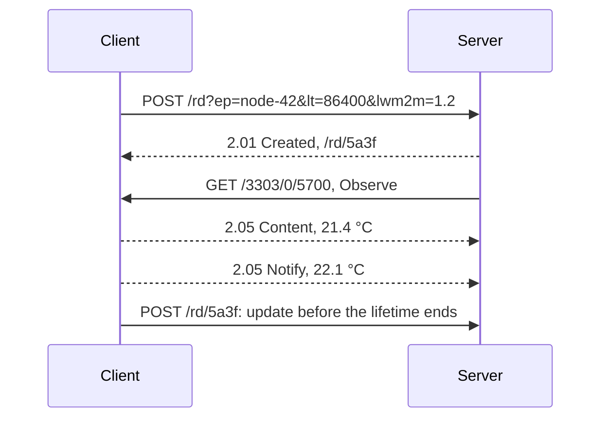
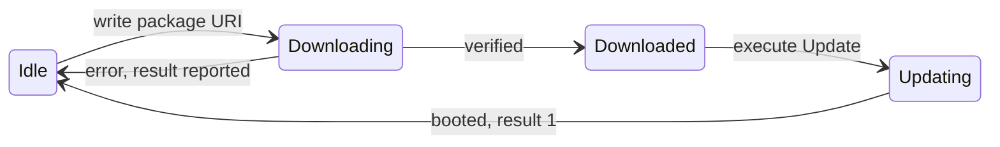

## Key figures {.stats style=tiles}

| Value | Label |
|---|---|
| 4 bytes | The CoAP header that LwM2M rides on |
| 5683, 5684 | CoAP's UDP ports, plain and with DTLS |
| 4 interfaces | Bootstrap, registration, management and reporting |
| 3 numbers | Object, instance, resource: /3303/0/5700 |

## Introduction {.abstract}

**LwM2M** is the Open Mobile Alliance's protocol for managing IoT devices and collecting their data. It runs on **CoAP**, fits microcontrollers with a few kilobytes of RAM, and works well over links such as **NB-IoT**. Every device exposes the same numbered tree of objects, so one server can manage devices from any maker.

## 1. Three roles

```cards cols=1 style=top
Client | On the device: sensors, settings and firmware, as numbered objects | navy
Bootstrap server | Gives a new device its server addresses and keys, once | blue
LwM2M server | Reads, writes and observes, and starts firmware updates | green
```

| Layer | LwM2M 1.0 | Added in 1.1 and 1.2 |
|---|---|---|
| Messaging | CoAP | CoAP over TCP, MQTT, HTTP |
| Security | DTLS | TLS, OSCORE |
| Transport | UDP, SMS | TCP, non-IP (NIDD), LoRaWAN |

## 2. A numbered tree

Every value has a path of three numbers. OMA and the IPSO registry assign them, so any server knows what `/3303/0/5700` is.

```syntax-anatomy
coaps://lwm2m.example.com:5684/3303/0/5700
coaps | Scheme: CoAP over DTLS | navy
lwm2m.example.com | Server | blue
5684 | Port | grey
3303 | Object: temperature | green
0 | Instance: the first sensor | amber
5700 | Resource: the reading | red
```

| Object | Name | Holds |
|---|---|---|
| 0 | Security | Server URIs, keys, certificates |
| 1 | Server | Lifetime, binding, notification rules |
| 2 | Access control | Who may read, write or execute what |
| 3 | Device | Maker, model, serial, battery, reboot |
| 4 | Connectivity | Bearer, signal, IP, cell |
| 5 | Firmware update | Package URI, state, result |
| 3303 | IPSO temperature | Reading 5700, units 5701, minimum 5601, maximum 5602 |

## 3. Four interfaces

```cards cols=1 style=top
Bootstrap | Request, write, read, discover, delete, finish: credentials and server addresses | navy
Registration | Register, update, de-register: endpoint name, lifetime and objects | blue
Management | Read, write, execute, create, delete, write-attributes | green
Reporting | Observe, notify, cancel, send: readings when they change | amber
```



## 4. A notification on the air

```hex-dissect cols=8 title="A CoAP notification"
bytes: 54 45 7a 31 d2 ab 3c 01 c0 ff 32 31 2e 34
0 | Ver 1, type NON, token length 4 | 0x54 | navy
1 | Code | 2.05 Content | blue
2-3 | Message ID | 0x7a31 | green
4-7 | Token | d2 ab 3c 01 | amber
8 | Option | Content-Format 0: text/plain | purple
9 | Payload marker | 0xff | grey
10-13 | Payload | 21.4 | red
```

## 5. Report only what matters

The server sets **Observe** attributes; the client checks them itself and wakes its radio only when a reading matters.

```lanes
Polling | *Wake, poll | *Wake, poll | *Wake, poll | *Wake, poll
Observe | *Send | Asleep: no change | Asleep: no change | *Threshold crossed
Queue mode (Q) | *Client updates | Server holds requests | Asleep in PSM | *Wakes, receives
```

| Attribute | Name | Notify when |
|---|---|---|
| pmin | Minimum period | No sooner than this many seconds after the last |
| pmax | Maximum period | At least this often, even with no change |
| gt, lt | Greater, less than | The value crosses above gt or below lt |
| st | Step | The value moves by st from the last report |

> [!TIP]
> `PUT /3303/0/5700?pmin=60&pmax=3600&st=0.5` reports a half-degree jump within a minute, and otherwise sends one heartbeat an hour.

## 6. Firmware update

Object 5 downloads from a URI, or takes pushed CoAP blocks, and reports its state:



| Result | Meaning |
|---|---|
| 1 | Updated |
| 2 | Not enough flash |
| 3 | Out of RAM |
| 4 | Connection lost while downloading |
| 5 | Integrity check failed |
| 6 | Unsupported package type |
| 7 | Invalid URI |
| 8 | Update failed |

## 7. Security and encodings {style=card colour=navy}

```cards cols=1 style=label
Pre-shared key | The smallest, fastest DTLS handshake
Raw public key | An asymmetric key set at the factory, with no certificate chain
X.509 | Full PKI, with automatic enrolment (EST)
OSCORE | Encrypts the CoAP message itself, end to end
```

| Format | Since | For |
|---|---|---|
| Plain text, opaque, TLV | 1.0 | Single values, blobs, compact arrays |
| SenML, JSON or CBOR | 1.1 | Time-stamped batches |
| LwM2M CBOR | 1.2 | The smallest single and composite reads |

## 8. Versions {.wide}

```timeline
2017 | LwM2M 1.0 | Objects 0 to 7, CoAP over UDP and SMS, DTLS, TLV and JSON | navy
2018 | LwM2M 1.1 | CoAP over TCP, non-IP and LoRaWAN, SenML CBOR, Send, OSCORE, EST | blue
2020 | LwM2M 1.2 | MQTT and HTTP transports, LwM2M CBOR, gateways | green
```

## 9. Glossary {.wide}

```glossary cols=4
CoAP | Constrained Application Protocol, RFC 7252
DTLS | TLS over datagrams
FOTA | Firmware over the air, through object 5
IPSO | Smart objects, IDs 3300 and up
NIDD | Non-IP data delivery
OMA | Open Mobile Alliance (OMA SpecWorks)
PSK, RPK | Pre-shared key, raw public key
SenML | Sensor Measurement Lists, RFC 8428
```

## In short {.summary}

LwM2M gives every constrained device the same numbered object tree and compact CoAP operations, so one server can provision, read and update them all.

### One data model

Numbered paths mean the same thing on every vendor's device.

### Little radio traffic

A 4-byte header, UDP, CBOR and Observe rules keep each exchange to one packet.

### The whole life of a device

Bootstrap, telemetry, connectivity and firmware updates, in one protocol.

## References {.references}

1. OMA SpecWorks, *Lightweight Machine to Machine Technical Specification, Core*, version 1.2.
2. IETF RFC 7252, *The Constrained Application Protocol (CoAP)*; RFC 8428, *Sensor Measurement Lists (SenML)*.
