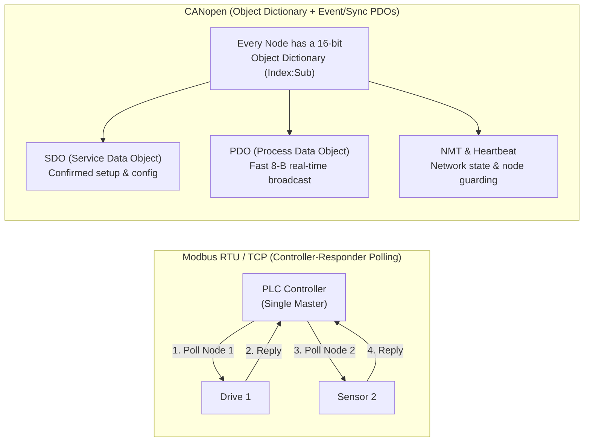

## Key figures {.stats style=tiles}

| Value | Label | Change | Verdict |
|---|---|---|---|
| 4 tables | Modbus data model: Coils, Discrete Inputs, Input & Holding Registers | 16-bit words | good |
| 247 nodes | Maximum logical responder addresses on a Modbus serial network | `1` to `247` (`0` = broadcast) | good |
| 8 bytes | Classic CANopen Process Data Object (`PDO`) real-time payload | zero protocol header | good |
| 29-bit ID | Extended ID used by `SAE J1939` Parameter Group Numbers (PGN) | priority + PGN + source | good |

## Introduction {.abstract}

Factories, solar farms and heavy vehicles rely on two families of industrial protocols over differential twisted-pair cables. **Modbus**—operating as **Remote Terminal Unit (RTU)** over **Recommended Standard 485 (`RS-485`)** or over **Transmission Control Protocol (TCP)**—polls four flat tables of 1-bit coils and 16-bit registers. **Controller Area Network (CAN)** protocols—led by **CANopen** and **`SAE J1939`**—use a structured **Object Dictionary**. Nodes broadcast real-time **Process Data Objects (`PDOs`)** on events without waiting for a poll.

## 1. Modbus data model & function codes

Every Modbus device exposes up to four address tables. Watch out for the classic **1-based documentation vs 0-based wire address** offset (`Register 40001` in a manual is wire address `0x0000` with Function Code `0x03`):

| Modbus Table | Bit Width | Access | Classic Doc Prefix | Wire Function Codes (`Hex`) |
|---|---|---|---|---|
| **Coils** | `1-bit` boolean | Read / Write | `0xxxx` (`00001..`) | `0x01` Read, `0x05` Write Single, `0x0F` Write Multiple |
| **Discrete Inputs** | `1-bit` boolean | Read-Only | `1xxxx` (`10001..`) | `0x02` Read Discrete Inputs |
| **Input Registers** | `16-bit` word | Read-Only | `3xxxx` (`30001..`) | `0x04` Read Input Registers (sensors, analogue readings) |
| **Holding Registers** | `16-bit` word | Read / Write | `4xxxx` (`40001..`) | `0x03` Read, `0x06` Write Single, `0x10` Write Multiple |

```figure
@segments
title: Modbus RTU Frame over RS-485 (Big-Endian registers, Little-Endian CRC-16!)
1 | Slave ID (1 B) | 1..247 | navy
1 | Func Code (1 B) | e.g. 0x03 | amber
4 | Data: Start Address (2 B) + Register Count / Values (N B) | Big-Endian! | blue
2 | CRC-16/MODBUS (2 B) | Low byte first! | teal
+++
@segments
title: Modbus TCP Frame over Ethernet (Port 502 — replaces CRC with 7-byte MBAP Header)
4 | MBAP Header: Transaction ID (2 B) + Protocol ID 0x0000 (2 B) + Length (2 B) + Unit ID (1 B) | 7 B | purple
4 | PDU: Function Code (1 B) + Register Address & Payload (N B) | Identical PDU | blue
```

## 2. Decoding a live Modbus transaction

```lcd cols=1
TX (Controller -> Node 0x01: Read 2 Holding Registers starting at 0x006B):
  [01] [03] [00 6B] [00 02] [B5 D6]
  ID=1  FC=3  Addr=107 Count=2 CRC=0xD6B5 (sent low-byte 0xB5 first!)

RX (Node 0x01 -> Controller: Returns 4 bytes = 2 × 16-bit registers):
  [01] [03] [04] [02 2B] [00 64] [CA 63]
  Reg 107 = 0x022B (55.5 C), Reg 108 = 0x0064 (100 RPM)
-- If an error occurs, Responder sets MSB of Function Code (0x83) + Exception Code!
```

> [!WARNING]
> Standard Modbus defines how to send **16-bit registers**, not 32-bit floats (`IEEE 754`). Vendors split 32-bit values across two registers in four possible byte/word orders (`ABCD`, `CDAB`, `BADC`, `DCBA`). Always document your word endianness!

## 3. CANopen & `SAE J1939`: beyond polling {.wide}

Because `RS-485` has no hardware collision arbitration, a Modbus sensor can never speak until the **Programmable Logic Controller (PLC)** polls it. **CANopen** (`CiA 301`) and **`SAE J1939`** leverage CAN bus bitwise arbitration so any node can transmit an urgent event immediately:



```compare
| Modbus RTU (`RS-485`) | Modbus TCP (`Ethernet`) | CANopen (`CiA 301` over CAN) | `SAE J1939` (Heavy Vehicles)
Physical layer | `RS-485` twisted pair (`9.6`–`115.2 kbps`) | Standard Ethernet (`100 Mbps`, port `502`) | `ISO 11898` CAN (`125 kbps`–`1 Mbps`) | `ISO 11898` CAN (`250` / `500 kbps`)
Communication model | Strict Master-Slave polling | Client-Server request/response | Peer-to-peer **PDO** + Client-Server **SDO** | Cyclic & event broadcast **PGNs**
Urgent alarm latency | Slow (must wait for poll turn) | Fast if polled frequently | **Sub-millisecond** (high-priority `EMCY` frame) | **Millisecond** (priority 0–7 in 29-bit ID)
Data organisation | Flat 16-bit register numbers | Flat 16-bit register numbers | Standardised `[16-bit Index : 8-bit Subindex]` | Standardised **Parameter Group Numbers (`PGN`)** & `SPNs`
```

## 4. Inside a CANopen object dictionary

Every parameter in a CANopen device lives at a 16-bit **Index** and 8-bit **Subindex** (`0x1000–0x1FFF` communication profile, `0x2000–0x5FFF` vendor specific, `0x6000+` device profile such as `CiA 402` motor drives). The 11-bit CAN Identifier (**Communication Object Identifier, `COB-ID`**) encodes a 4-bit **Function Code** and 7-bit **Node ID (`1..127`)**:

```cards cols=4 style=top
NMT (COB-ID 0x000) | Network Management: transitions nodes between Initialising, Pre-Operational, Operational and Stopped states | navy
EMCY (0x080 + NodeID) | Emergency Object: high-priority 8-byte fault frame transmitted immediately when hardware detects an error | red
TPDO / RPDO (0x180..0x57F) | Transmit & Receive Process Data Objects: pack up to 64 bits of mapped Object Dictionary variables with zero protocol overhead | green
SDO (0x580 / 0x600 + ID) | Service Data Object: confirmed read/write mailbox to any `[Index:Subindex]` for configuration and firmware updates | amber
```

## 5. Fieldbus implementation checklist {style=card colour=amber}

```checklist
[x] Document Modbus register addresses using **both** 0-based wire offset (`0x006B`) and 1-based PLC notation (`40108`)
[x] Specify exact byte and word order (`Big-Endian ABCD` vs `Word-Swapped CDAB`) for all 32-bit `float` and `int32` register pairs
[x] Return standard Modbus Exception Codes (`0x01` Illegal Function, `0x02` Illegal Address, `0x03` Illegal Value) instead of timing out silently
[x] Ship an Electronic Data Sheet (`.eds` file) for every CANopen product so PLC tools can map `PDOs` and `SDOs` automatically
[x] Implement galvanic isolation (`2.5 kV` digital isolator + isolated DC-DC) on industrial `RS-485` and `CAN` transceivers
```

## 6. Acronym guide: every term defined {.wide}

```cards cols=4 style=label
RTU & PDU | Remote Terminal Unit (binary serial framing) and Protocol Data Unit (Function Code + Data inside Modbus)
MBAP | Modbus Application Protocol header: 7-byte prefix added to Modbus PDU when carried over TCP/IP port 502
PLC & HMI | Programmable Logic Controller (industrial control computer) and Human-Machine Interface (operator touch panel)
COB-ID | Communication Object Identifier: the 11-bit CAN frame ID split into a 4-bit Function Code and 7-bit Node ID
PDO & SDO | Process Data Object (fast unconfirmed real-time broadcast) and Service Data Object (confirmed dictionary access)
NMT & EMCY | Network Management (node state machine control) and Emergency high-priority fault message in CANopen
EDS & OD | Electronic Data Sheet (INI-style device description file) and Object Dictionary (`[Index:Subindex]` table)
PGN & SPN | Parameter Group Number (message ID) and Suspect Parameter Number (signal field) in SAE J1939 truck networks
```

## In short {.summary}

Use **Modbus RTU (`RS-485`)** or **Modbus TCP** for PLCs and meters that expect simple polled registers. Use **CANopen** or **`SAE J1939`** when drives, sensors and actuators need millisecond event-driven coordination.

### Beware the off-by-one address trap

Always list both the hexadecimal wire address (`0x0000`) and the traditional 5-digit PLC address (`40001`) in your manual.

### Broadcast fast data, poll configuration

Configure a CANopen motor drive at startup via `SDO`, then stream velocity setpoints and encoder feedback in 8-byte `PDOs`.

### Isolate field wiring

Factory ground loops destroy unprotected microcontrollers; always isolate industrial `RS-485` and `CAN` interfaces.
