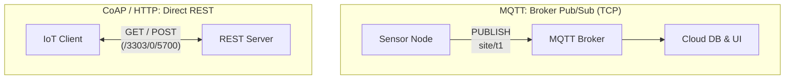

## Key figures {.stats style=tiles}

| Value | Label | Change | Verdict |
|---|---|---|---|
| 2 bytes | Minimum Message Queuing Telemetry Transport (MQTT) fixed header | persistent stream | good |
| 4 bytes | Constrained Application Protocol (CoAP) header over datagrams | 1-packet wake | good |
| 9+ packets | Packets to open stream, encrypt, send one web request and close | high radio cost | bad |
| 3 levels | MQTT Quality of Service (`QoS 0`, `QoS 1`, `QoS 2`) delivery guarantees | configurable | good |

## Introduction {.abstract}

When an **Internet of Things (IoT)** device sends sensor readings or receives commands, the application protocol determines how many packets cross the radio and how servers address the device. **Hypertext Transfer Protocol (HTTP)** is universal on the web, but verbose text headers and **Transmission Control Protocol (TCP)** and **Transport Layer Security (TLS)** handshakes drain batteries on cellular links. **Message Queuing Telemetry Transport (MQTT)** decouples devices through a central publish-subscribe broker over a persistent **TCP** connection. **Constrained Application Protocol (CoAP)** brings compact 4-byte binary **Representational State Transfer (REST)** semantics to **User Datagram Protocol (UDP)**.

## 1. Communication models: broker vs direct

**MQTT** routes messages by topic name through a central broker. **CoAP** and **HTTP** follow **REST**, where a client acts on **Uniform Resource Identifiers (URI)** such as `/sensors/temp`:

```cards cols=1 style=top
MQTT (Publish / Subscribe) | Devices publish to hierarchical topic strings (`site/floor1/temp`) on a central broker; any number of subscribers receive a copy without knowing each other | green
CoAP (Compact UDP REST) | Binary 1-to-1 request/response over UDP with built-in `Observe` subscriptions and optional confirmable (`CON`) retries; ideal for sleeping nodes and LwM2M | navy
HTTP / REST (Web Standard) | Text or binary headers over TCP and Transport Layer Security (TLS); effortless cloud integration for mains-powered gateways and Wi-Fi appliances | blue
```



[[CAPTION:Figure]] MQTT routes messages via a broker; CoAP and HTTP exchange requests and responses directly.

## 2. Wire overhead and wake time

On a battery-powered cellular node that wakes from deep sleep once an hour, connection setup dominates energy consumption. Because **CoAP** runs over connectionless **UDP**, a complete report and acknowledgement takes just **2 packets**:

```figure
@segments
title: Minimum protocol header size before payload
1 | MQTT (2 B) | Fixed | green
2 | CoAP (4 B) | Binary | navy
9 | HTTP/1.1 (80–400+ B) | ASCII text headers | amber
+++
@lanes
CoAP (UDP) | *Send CON (1 pkt) | *Recv ACK (1 pkt) | Sleep immediately
MQTT (TCP) | *TCP SYN/ACK | *TLS setup | *CONNECT + PUBLISH
HTTP (TCP) | *TCP SYN/ACK | *TLS setup | *Request + 200 OK
```

```chart type=bar title="Total air bytes for one 20-byte report after sleep" unit=" B" max=1800
CoAP + DTLS CID | 96
MQTT + TLS Resume | 380
MQTT Full TLS | 1420
HTTPS Full TLS | 1680
```

## 3. Delivery guarantees and keep-alive

Both MQTT and CoAP provide application-layer delivery confirmation tailored to their transport:

```cards cols=2 style=label
MQTT QoS 0 | Fire and forget over TCP; no application ACK
MQTT QoS 1 | Broker replies with PUBACK; retries until acknowledged
MQTT QoS 2 | Four-part handshake (exactly once); highest radio cost
CoAP CON / NON | Confirmable (CON) requires an ACK over UDP; NON does not
```

```lcd cols=1
PUBLISH topic="factory/pump4/vibration"
QoS=1 Retain=1 Dup=0 MsgID=0x1042
Payload: {"rms_mm_s": 2.8, "temp_c": 54.1}
-- MQTT QoS 1 retained message + Last Will (LWT)

CON POST [MID=0x7A11] Token=0x53
Uri-Path: "sensors", "temp"  Format: CBOR (60)
-- CoAP Confirmable request (4-byte header)
```

> [!TIP]
> In **MQTT**, configure a **Last Will and Testament (LWT)** message when connecting (`status = offline` with `Retain = true`). If the device loses power, the broker publishes the LWT automatically.

## 4. Head-to-head comparison: MQTT vs CoAP vs HTTP {.wide}

```compare
| HTTP/1.1 & HTTP/2 | MQTT (v3.1.1 / v5.0) | CoAP (RFC 7252)
Architecture | Client / Server (REST) | Publish / Subscribe (Broker) | Client / Server + Observe (REST)
Primary transport | TCP | TCP (or WebSockets) | UDP (also TCP, SMS, Non-IP)
Security layer | Transport Layer Security (TLS) | TLS (port 8883) | Datagram Transport Layer Security (DTLS, port 5684)
Header format | Verbose ASCII text (or HPACK in HTTP/2) | 2-byte binary + UTF-8 topic string | 4-byte binary + compact Type-Length-Value options
Async server push | Needs polling, Server-Sent Events or WebSockets | Native (broker pushes to subscribers) | Native (`Observe` option on GET)
Device management | Custom JSON endpoints | Custom topic schemas (or Sparkplug B) | Standardised via Open Mobile Alliance (OMA) LwM2M
Best power profile | Mains power or Wi-Fi | Always-connected gateways & short sleep | Multi-year coin/lithium cell (NB-IoT / LoRaWAN)
```

## 5. Protocol selection workflow {cols=2}

Pick the protocol that matches your link layer, sleep duty cycle and backend architecture:

```flow
[Sleeps in PSM on NB-IoT / UDP?|navy] -yes-> [CoAP (+ LwM2M)|navy]
[Always-on or frequent bi-directional events?|navy] -yes, many-to-many-> [MQTT over TLS|green]
[Connecting directly to existing web APIs on Wi-Fi / Ethernet?|amber] -yes-> [HTTPS REST|blue]
```

## 6. Production IoT messaging checklist {style=card colour=green}

Before deploying a fleet of connected devices, verify these five practices using **Concise Binary Object Representation (CBOR)** and session resumption:

```checklist
[x] Never use plain unencrypted ports (1883 for MQTT, 5683 for CoAP, 80 for HTTP) on public networks
[x] Enable DTLS Connection Identifier or TLS session resumption so waking nodes skip full handshakes
[x] Prefix MQTT topics with a tenant and device ID (`v1/acme/dev-042/telemetry`) and enforce broker permissions
[x] Use binary CBOR payloads instead of verbose text JSON on narrowband cellular links
[x] Implement exponential backoff with random jitter on reconnects to prevent broker storms
```

## 7. Acronym guide: every term defined {.wide}

```cards cols=4 style=label
MQTT | Message Queuing Telemetry Transport: lightweight publish-subscribe messaging protocol over TCP
CoAP | Constrained Application Protocol: compact binary REST protocol (RFC 7252) designed for UDP and small nodes
HTTP / HTTPS | Hypertext Transfer Protocol (and HTTP Secure over TLS): standard request-response protocol of the web
REST & URI | Representational State Transfer (stateless resource architecture) and Uniform Resource Identifier
TCP / UDP | Transmission Control Protocol (connection-oriented streams) and User Datagram Protocol (connectionless datagrams)
TLS / DTLS | Transport Layer Security (for TCP) and Datagram Transport Layer Security (for UDP packets)
QoS & LWT | Quality of Service (MQTT delivery guarantee 0, 1 or 2) and Last Will and Testament (disconnect alert)
CON / NON / ACK | Confirmable, Non-confirmable and Acknowledgement message types in CoAP
CBOR & JSON | Concise Binary Object Representation and JavaScript Object Notation payload formats
LwM2M & OMA | Lightweight Machine-to-Machine device management standard from the Open Mobile Alliance
PSM & NIDD | Power Saving Mode (deep cellular sleep) and Non-IP Data Delivery (headerless cellular transport)
NAT & ACL | Network Address Translation (router timeout table) and Access Control List (per-device topic permissions)
```

## In short {.summary}

Choose `CoAP` over `UDP` when sleeping battery devices wake to send a single packet; choose `MQTT` over `TCP` for event-driven publish-subscribe streams; choose `HTTPS` when power and bandwidth are plentiful.

### Deep-sleep battery efficiency

With no TCP handshake and a 4-byte binary header, a CoAP report over UDP finishes in two packets before returning to sleep.

### Real-time broker fan-out

A persistent MQTT connection lets a broker route telemetry and commands between thousands of devices and cloud services in milliseconds.

### Payloads and handshakes matter

Combining binary CBOR payloads with DTLS or TLS session resumption cuts cellular air time by more than 80%.

## References {.references}

1. MQTT Version 5.0 Standard Specification, 2019.
2. Internet Engineering Task Force (IETF) Request For Comments (RFC) 7252, *The Constrained Application Protocol (CoAP)*, 2014.
