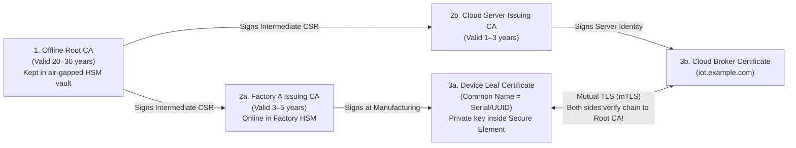

## Key figures {.stats style=tiles}

| Value | Label | Change | Verdict |
|---|---|---|---|
| 3 tiers | Root Certificate Authority (CA), Intermediate CA and Leaf Certificate | chain of trust | good |
| 64 bytes | Size of an `ECDSA P-256` signature (`32 B` for `Ed25519`) | vs `256 B` `RSA-2048` | good |
| 0 exports | Private key generated inside a Secure Element never leaves the chip | hardware isolated | good |
| 1 node | Blast radius when an administrator revokes a unique X.509 certificate | vs shared password | good |

## Introduction {.abstract}

How does a cloud server know that a connecting sensor is a genuine device built on your factory line rather than an attacker spoofing its serial number? Hardcoding a shared password or global **Pre-Shared Key (PSK)** across a fleet means that dumping the Flash memory of one stolen unit compromises every unit in the world. **Public Key Infrastructure (PKI)** solves this at scale: each device holds a unique **asymmetric key pair** inside a tamper-resistant **Secure Element (`SE`)** or **Trusted Platform Module (TPM)**. It also carries an **X.509 certificate** signed by your **Certificate Authority (CA)**.

## 1. The three-tier certificate authority hierarchy {.wide}

Never sign device certificates directly with your **Root CA**. Keep the Root CA private key air-gapped in a vault, and delegate daily factory signing to an **Intermediate Issuing CA**:



[[CAPTION:Figure]] During Mutual Transport Layer Security (`mTLS`), the device verifies the server's certificate chain and the server verifies the device's certificate chain.

## 2. Anatomy of an X.509 v3 device certificate

An **X.509** certificate (`RFC 5280`) binds a **Subject** identity (such as device serial number `SN-0049182`) to its **Public Key**, signed by the **Issuer CA**:

```figure
@segments
title: Compact ECDSA X.509 Certificate in DER Binary Format (~350 to 500 bytes)
2 | Version, Serial Number & Validity Dates (NotBefore / NotAfter) | Metadata | navy
2 | Issuer DN (Factory CA) & Subject DN (Device UUID) | Identity | blue
2 | Subject Public Key Info (EC P-256 = 65 bytes) | Public Key | green
2 | X.509v3 Extensions (KeyUsage, BasicConstraints: CA=FALSE) | Policy | amber
2 | Issuer CA Digital Signature (ECDSA-SHA256 = 64 bytes) | Tamper Seal | red
```

> [!TIP]
> On constrained microcontrollers, store certificates in binary **Distinguished Encoding Rules (`DER`)** format rather than Base64 **Privacy-Enhanced Mail (`PEM`)** text (`-----BEGIN CERTIFICATE-----`), saving **30%** in Flash and parsing RAM.

## 3. Where the private key lives {.wide}

An X.509 certificate is public, but the corresponding **Private Key** must never be readable by attackers with a debug probe or chip decapping lab:

```compare
| Plain Microcontroller Flash | MCU Trusted Execution (`ARM TrustZone`) | Discrete Secure Element (`ATECC608` / `SE050`) / `TPM 2.0`
Where private key is stored | General internal Flash sector | Isolated Secure Flash partition (`TF-M`) | Dedicated tamper-resistant crypto chip over `I2C` / `SPI`
Vulnerability to `SWD` dump | **High** if Readout Protection (`RDP`) is bypassed | Protected against Non-Secure software bugs | **Immune** (key never crosses `I2C` bus; only signatures return)
Physical side-channel defence | None (vulnerable to voltage glitching) | Basic clock/voltage monitors | **Active metal shield, glitch sensors & constant-time gates**
Factory provisioning | Must generate & flash key on your line | Generate on-chip at first boot | **Pre-provisioned** at chip foundry with signed certificates!
Added Bill of Materials cost | `$0.00` | `$0.00` (built into Cortex-M33 / M55) | `~$0.35 to $1.20` per board
```

## 4. Zero-touch factory provisioning workflow

How do you get a signed certificate into 100,000 devices without exposing private keys on the factory floor?

```steps
1. On-Chip Key Generation | The Secure Element's internal True Random Number Generator (`TRNG`) generates an `ECDSA P-256` key pair inside its locked key slot; the private key can never be exported
2. Export CSR | Test fixture asks the Secure Element to sign a Certificate Signing Request (`CSR`, `PKCS#10`) containing the public key and unique hardware serial number | blue
3. Factory CA Issuance | Fixture sends the `CSR` to the Factory Issuing CA (or uses pre-provisioned wafer certificates), receiving the signed binary `DER` leaf certificate | amber
4. Store Cert & Lock Config | Fixture writes the public certificate into Flash or Secure Element EEPROM, locks the configuration zone permanently, and registers the device thumbprint in the cloud | green
```

```lcd cols=1
// Device proves possession of private key during mTLS handshake:
// 1. MCU hashes TLS handshake transcript (32-byte SHA-256 digest)
// 2. MCU sends 32-byte digest to Secure Element over I2C:
atcab_sign(SLOT_DEVICE_PRIVKEY, transcript_sha256, sig_64b);
// 3. Secure Element returns 64-byte ECDSA signature (key never leaves chip!)
-- Even if an attacker dumps all MCU Flash, they cannot impersonate the node!
```

## 5. Certificate rotation & revocation checklist {style=card colour=red}

```checklist
[x] Use **Elliptic Curve (`ECDSA P-256` or `Ed25519`)** keys instead of `RSA-2048` to cut certificate size and handshake time by `80%`
[x] Keep the **Root CA** completely offline; sign device certificates with a short-lived **Intermediate Issuing CA**
[x] Pin the **Root CA** (plus a backup Root CA public key) in firmware so you can rotate Intermediate CAs without bricking connections
[x] Maintain an **Accurate Real-Time Clock (`RTC` / `NTP`)** on the device so it can check `NotBefore` and `NotAfter` certificate expiry dates
[x] Build a cloud device-registry blocklist so a stolen or decommissioned device certificate can be revoked immediately
```

## 6. Acronym guide: every term defined {.wide}

```cards cols=4 style=label
PKI & CA | Public Key Infrastructure and Certificate Authority: system of digital certificates and trusted issuers binding keys to identities
X.509 & CSR | Standard certificate format (RFC 5280) and Certificate Signing Request (PKCS#10 message requesting a CA signature)
DER & PEM | Distinguished Encoding Rules (compact binary ASN.1 encoding) and Privacy-Enhanced Mail (Base64 text wrapper)
mTLS | Mutual Transport Layer Security: two-way authentication where both client device and cloud server present X.509 certificates
TPM & HSM | Trusted Platform Module (board security chip) and Hardware Security Module (tamper-proof server vault for CA keys)
ECDSA & RSA | Elliptic Curve Digital Signature Algorithm (compact 256-bit keys) and Rivest-Shamir-Adleman legacy public-key crypto
CRL & OCSP | Certificate Revocation List and Online Certificate Status Protocol: mechanisms for checking whether a certificate was revoked
TRNG & TF-M | True Random Number Generator (physical entropy source) and Trusted Firmware-M (open-source ARM TrustZone reference)
```

## In short {.summary}

Give every device a unique **`ECDSA P-256` private key** locked inside a **Secure Element** or **TrustZone** partition. Sign its **X.509 certificate** with an **Intermediate CA**, and authenticate connections with **Mutual Transport Layer Security (`mTLS`)**.

### Never share a fleet secret

If ten thousand devices share one credential, reverse-engineering one unit compromises all ten thousand; unique X.509 certificates isolate each unit.

### Keep private keys off the bus

When a Secure Element signs the handshake challenge internally, reading out the main microcontroller's Flash yields zero secret keys.

### Always pin a backup root key

Include a secondary offline Root public key in your bootloader and firmware so you have a recovery path when rotating an active CA.
