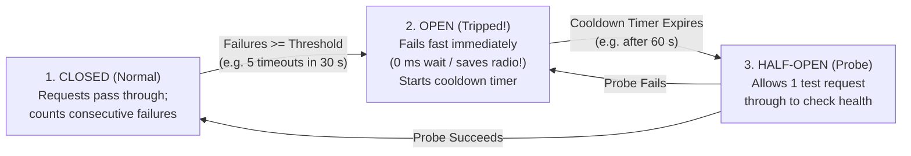

## Key figures {.stats style=tiles}

| Value | Label | Change | Verdict |
|---|---|---|---|
| 100,000x | Reconnect spike when a fleet retries on a fixed timer without **Jitter** | thundering herd | bad |
| 3 states | **Circuit Breaker** state machine: `Closed`, `Open` and `Half-Open` | stops cascade | good |
| 1 key | **Idempotency Key** (`UUID` or sequence number) making retries safe | exactly-once effect | good |
| Bounded | Every queue, cache and retry loop must have a hard capacity ceiling | backpressure | good |

## Introduction {.abstract}

In a distributed system—whether 50,000 cellular sensors reporting to an ingestion broker or microservices calling databases—networks drop packets, certificates expire and downstream servers stall. Naive failure handling makes outages worse: immediate retry loops trigger **thundering-herd retry storms** that knock recovering servers straight back down, while unbounded queues exhaust **Random-Access Memory (RAM)**. Resilient architecture combines five patterns: **Timeouts**, **Exponential Backoff with Full Jitter**, **Idempotency Keys**, **Circuit Breakers** and **Bounded Store-and-Forward Backpressure**.

## 1. Killing retry storms with backoff and jitter {.wide}

Suppose a cell tower or cloud broker reboots for 10 seconds while 10,000 devices maintain active sessions. If every device uses a fixed `5 s` retry or pure exponential backoff (`2 s, 4 s, 8 s`), all 10,000 devices slam the server in synchronised waves (**Thundering Herd**). Adding **random Full Jitter** spreads the load evenly across time:

```figure
@lanes
Bad: Fixed / Synchronised Retry (2s, 4s, 8s) | *10,000 nodes hit at t=2s (Crash!) | *10,000 hit at t=4s (Crash!) | *10,000 hit at t=8s (Crash!) | Server never recovers!
Good: Exponential Backoff + Full Jitter | *Nodes spread uniformly across 0..2s | *Remaining spread across 0..4s | *All nodes reconnected smoothly! | Zero traffic spikes
```

```lcd cols=2
// Formula for Cap-Bounded Exponential Backoff with Full Jitter:
// sleep_ms = random_uniform(0, min(MAX_BACKOFF_MS, BASE_MS * (2 ^ attempt)))

uint32_t calc_backoff_jitter_ms(uint8_t attempt) {
  uint8_t shift = (attempt > 10U) ? 10U : attempt;
  uint32_t exp_cap = MIN(300000UL, 1000UL * (1UL << shift)); // Cap at 5 min
  return trng_random_u32() % (exp_cap + 1UL); // Full jitter: 0..exp_cap!
}
-- Always seed the random generator from a hardware TRNG or unique Device ID!
-- If every MCU boots with rand() seed = 1, they all pick the exact same jitter!
```

## 2. The circuit breaker pattern

When a downstream service or external modem is failing, continuing to wait `30 seconds` on every request ties up threads and drains battery. A **Circuit Breaker** wraps the dependency in a three-state machine:



[[CAPTION:Figure]] When Open, the Circuit Breaker fails fast in microseconds and routes telemetry into local non-volatile flash storage until the cooldown expires.

## 3. Safe retries require Idempotency

In any network, **at-least-once delivery** is the norm. If a client sends a command, the server executes it, and the acknowledgement (`ACK`) drops in transit, the client will retry. Without **Idempotency**, the server executes the action twice!

```cards cols=2 style=top
Idempotent by Nature (`PUT` / `DELETE` / Absolute State) | Setting `target_valve_position = 40%` or `PUT /devices/42/config` can be repeated 10 times with the exact same result. Prefer absolute state over relative deltas (`adjust_valve(+10%)`)! | green
Idempotent via Idempotency Key (`POST` / Commands) | Attach a deterministic **`Idempotency-Key` (`UUID` or `[DeviceID + MonotonicSeqNum]`)**. The server stores processed keys in an atomic table: if it sees key `seq=1042` again, it returns the cached success reply without re-running the side effect | amber
```

## 4. Edge-to-cloud store-and-forward & backpressure {.wide}

What happens inside a sensor node or gateway when the internet connection drops for 48 hours?

```compare
| Naive Implementation | Resilient Architecture Pattern
Downstream dependency hangs | Calls block without timeout; all worker threads freeze | **Explicit Deadline / Timeout** on every socket, bus and RPC call + **Bulkhead** thread pools
Network offline for 24 hours | Drops readings or grows RAM queue until Out-Of-Memory (`OOM`) | **Bounded Circular Flash Ring Buffer (`Store-and-Forward`)** overwriting oldest low-priority logs
Producer faster than consumer | Unbounded queue grows until crash | **Explicit Backpressure**: bounded queue blocks producer, drops low-priority telemetry or sheds load (`HTTP 429`)
Poison pill / corrupt message | Crashes consumer, restarts, reads same message, crashes in loop! | **Dead-Letter Queue (`DLQ`)**: after `N` parse/process failures, quarantine message for inspection
```

```figure
@segments
title: Non-Volatile Flash Circular Ring Buffer (Store-and-Forward during cellular outage)
3 | Committed & ACKed by Cloud (Safe to overwrite) | Reclaimed | green
4 | Unsent Telemetry Backlog (Read Pointer -> Write Pointer) | Waiting for reconnect | amber
2 | Priority Alarm Reserve (Never overwritten by routine logs!) | Critical alerts | red
```

## 5. Distributed resilience checklist {style=card colour=amber}

```checklist
[x] Put an explicit **timeout** on every network socket, database query and hardware bus call (never use infinite timeout in production)
[x] Add **Full Jitter** (seeded from a hardware True Random Number Generator `TRNG`) to every reconnect and retry timer
[x] Include a unique `[DeviceID, SequenceNumber]` or `UUID` **Idempotency Key** in every mutating command and telemetry batch
[x] Bound every in-memory and flash queue; define an explicit overflow policy (`Drop Oldest` for telemetry, `Reject / Backpressure` for commands)
[x] Test resilience in Continuous Integration (`CI`) using fault injection (drop 20% of packets, delay ACKs by 5 seconds, kill broker mid-transfer)
```

## 6. Acronym guide: every term defined {.wide}

```cards cols=4 style=label
UUID | Universally Unique Identifier (128-bit ID): used as an Idempotency Key so retried requests are deduplicated safely
TRNG | True Random Number Generator: hardware entropy source required so fleet devices do not compute identical retry jitter
DLQ | Dead-Letter Queue: holding queue where corrupt or repeatedly failing ("poison pill") messages are isolated
OOM | Out-Of-Memory: system crash caused by unbounded queues or retry buffers growing when a downstream network stalls
RPC & REST | Remote Procedure Call and Representational State Transfer: network communication styles requiring explicit timeouts
ACK & NACK | Positive Acknowledgement and Negative Acknowledgement: transport or application confirmation messages
SLO & MTTR | Service Level Objective (uptime target) and Mean Time To Recovery (how fast a system heals after a fault)
CI | Continuous Integration: automated test pipeline running chaos and fault-injection scenarios
```

## In short {.summary}

Assume every network call will eventually time out. Bound every wait with a **timeout**, space out retries with **Exponential Backoff + Full Jitter**, make retries safe with **Idempotency Keys**, and buffer offline telemetry in a **bounded Flash ring**.

### Never retry without jitter

Synchronised retries turn a 5-second network blip into a self-inflicted denial-of-service attack across your entire device fleet.

### If you retry, you must be idempotent

Because a timeout could mean the request failed *or* the reply was lost, every retried operation must carry an Idempotency Key.

### Bound every queue

An unbounded queue is just a delayed out-of-memory crash; cap every buffer and decide up front whether to apply backpressure or overwrite the oldest sample.
