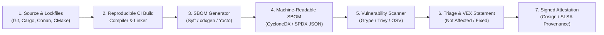

## Key figures {.stats style=tiles}

| Value | Label | Change | Verdict |
|---|---|---|---|
| 80%+ | Share of third-party & open-source libraries in modern firmware & cloud apps | hidden depth | bad |
| 2 standards | System Package Data Exchange (`SPDX`) and CycloneDX formats | global specs | good |
| 24 hours | Severe vulnerability reporting window under the Cyber Resilience Act (CRA) | legal mandate | bad |
| 4 statuses | Vulnerability Exploitability Exchange (`VEX`) states cutting false alarms | actionable | good |

## Introduction {.abstract}

Modern embedded firmware and cloud services assemble hundreds of open-source libraries, C/C++ packages and container layers. When a zero-day flaw emerges in a deep transitive dependency, engineering teams cannot defend what they cannot inventory. A **Software Bill of Materials (SBOM)** is a formal, machine-readable inventory of every component, version, cryptographic hash, licence and dependency relationship inside a build artefact. Paired with **Vulnerability Exploitability Exchange (`VEX`)** assertions and **Supply-Chain Levels for Software Artifacts (SLSA)** provenance signatures, an SBOM turns security triage into an instant query.

## 1. End-to-end secure supply-chain pipeline {.wide}

Generate the SBOM during compilation inside your **Continuous Integration (CI)** pipeline, scan it continuously and sign the attestation:



[[CAPTION:Figure]] Generating the SBOM at build time captures exact compiler flags, static C libraries and commit hashes that post-build binary scanners miss.

## 2. Comparing the two global SBOM standards {.wide}

Regulators worldwide accept both standards, and tools convert cleanly between them via **JavaScript Object Notation (JSON)**:

```compare
| System Package Data Exchange (SPDX) | CycloneDX (`OWASP` Standard)
Governance body | Linux Foundation (`ISO/IEC 5962:2021` international standard) | **Open Worldwide Application Security Project (OWASP)** (`ECMA-424`)
Original design focus | Open-source **licence compliance**, copyright attribution and legal provenance | **Application security**, vulnerability tracking and component risk analysis
Supported scope | Source files, packages, containers, operating systems and data | Software (`SBOM`), hardware, cryptography and cloud services
Serialisation formats | JSON, YAML, Extensible Markup Language (XML) and Tag-Value text | JSON, XML and Protocol Buffers (`Protobuf`)
Vulnerability integration | Links external advisories and supports security profiles in SPDX 3.0 | Native embedded support for **Common Vulnerabilities and Exposures (CVE)** and **VEX**
```

## 3. Anatomy of a machine-readable SBOM entry

Every component is uniquely identified by a standardised **Package Uniform Resource Locator (`purl`)** and a **Secure Hash Algorithm (SHA)** digest:

```lcd cols=1
{
  "bomFormat": "CycloneDX",
  "specVersion": "1.6",
  "components": [{
    "type": "library",
    "name": "mbedtls",
    "version": "3.6.0",
    "purl": "pkg:generic/arm/mbedtls@3.6.0",
    "hashes": [{"alg": "SHA-256", "content": "e3b0c44298fc1c..."}],
    "licenses": [{"license": {"id": "Apache-2.0"}}]
  }]
}
-- Exact purl + SHA-256 hash eliminates naming ambiguity across vendors
```

## 4. Cutting false-positive scanner noise

An SBOM lists every library linked into a product. Without context, scanners flag hundreds of unexploitable **Common Vulnerabilities and Exposures (CVE)** records in unused code paths. **Vulnerability Exploitability Exchange (`VEX`)** solves this by letting the manufacturer publish a signed exploitability status for each CVE:

```cards cols=2 style=top
Not Affected | No remediation required; accompanied by a machine-readable justification such as `vulnerable_code_not_present` or `vulnerable_code_not_in_execute_path` | green
Affected | The vulnerability is reachable in this product configuration; includes recommended mitigations or firewall workarounds until a patch ships | red
Fixed | This specific product release already contains the patched library version or a backported source-code security fix | blue
Under Investigation | The product security team is actively analysing whether the vulnerable function can be triggered in the field | amber
```

## 5. Build pipeline integrity with SLSA

An SBOM is only trustworthy if attackers cannot tamper with the build server that produced it. **SLSA** defines incremental build integrity levels:

```steps
SLSA Level 1: Provenance exists | Automated build script generates a machine-readable provenance document listing the source repository, commit hash and build inputs
SLSA Level 2: Hosted & signed | Build runs on a hosted CI service that cryptographically signs the provenance attestation so consumers can verify authenticity | amber
SLSA Level 3: Hardened isolated builds | Ephemeral, isolated build sandboxes prevent build jobs from tampering with each other or exfiltrating signing keys | green
```

## 6. Regulatory & DevSecOps compliance checklist {style=card colour=amber}

Governments now mandate SBOM delivery and vulnerability transparency under laws such as the European Union **Cyber Resilience Act (CRA)**:

```checklist
[x] Generate a fresh CycloneDX or SPDX JSON document automatically on every release build in CI
[x] Include both direct and transitive dependencies (including statically linked C/C++ libraries and RTOS modules)
[x] Identify every component with a standard Package URL (`purl`) and a cryptographic `SHA-256` checksum
[x] Publish machine-readable VEX statements alongside firmware releases so customers filter out non-exploitable CVEs
[x] Sign both the release binary and its SBOM attestation using hardware-backed keys (`Sigstore Cosign` or PKI)
```

## 7. Acronym guide: every term defined {.wide}

```cards cols=4 style=label
SBOM | Software Bill of Materials: machine-readable inventory of all software components, licences and hashes in a build
SPDX | System Package Data Exchange: Linux Foundation and ISO/IEC 5962 standard for software bill of materials data
OWASP | Open Worldwide Application Security Project: foundation governing the CycloneDX security standard
CVE | Common Vulnerabilities and Exposures: public catalogue of disclosed cybersecurity flaws with unique identifiers
VEX | Vulnerability Exploitability Exchange: machine-readable assertion stating whether a CVE actually affects a product
SLSA | Supply-Chain Levels for Software Artifacts: framework for tamper-proof build provenance and integrity
CRA | Cyber Resilience Act: European Union regulation mandating SBOMs and lifecycle security for connected products
JSON & XML | JavaScript Object Notation and Extensible Markup Language: standard structured text formats for SBOM exchange
```

## In short {.summary}

Generate an **SBOM** automatically during every CI build. Pair it with `VEX` exploitability statements to silence false-positive alerts, and sign both the binary and the SBOM with **SLSA** attestations.

### You cannot patch what you cannot list

When a critical library vulnerability breaks, an indexed SBOM database tells you every affected firmware version in seconds.

### Silence false alarms with exploitability data

Publishing a `VEX` document stops customers from panicking over CVEs in dead code paths that attackers cannot trigger.

### Sign the build provenance

Cryptographic SLSA attestations prove that a trusted CI runner built your binary from reviewed source code.
