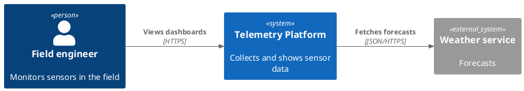
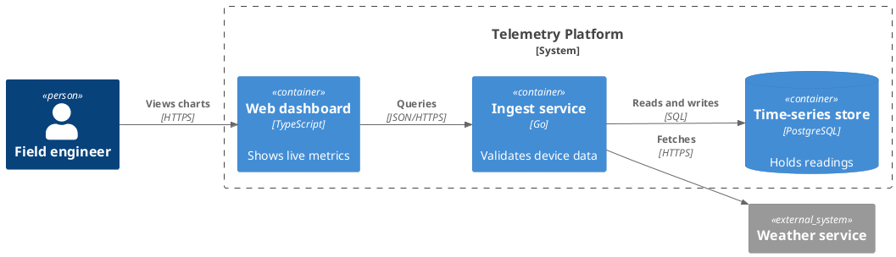

## Key figures {.stats style=tiles}

| Value | Label |
|---|---|
| 4 levels | Context, containers, components and code |
| 5 elements | Person, software system, container, component, relationship |
| 1 model | In text, from which every view is drawn |
| Levels 1 and 2 | Enough for most teams |

## Introduction {.abstract}

Most whiteboard diagrams mix levels of abstraction and leave boxes and arrows unexplained. Simon Brown's **C4 model** gives a hierarchy of maps: like zooming a map, each reader looks at the level of detail they need. Every box states its **name**, its **type**, its **technology** and its **responsibility**, and every arrow says what it does and how.

## 1. Four levels of zoom {.wide}

Each level zooms into one box of the level above:

```cards cols=4 style=top
Level 1: system context | The system as one box, with the people who use it and the systems it talks to | navy
Level 2: containers | Inside the system: the separately deployable parts, such as web apps, services, firmware and databases | blue
Level 3: components | Inside one container: its main building blocks and their responsibilities | teal
Level 4: code | Inside one component: classes and interfaces, generated by the IDE when needed | green
```

## 2. Level 1: system context



## 3. Level 2: containers



## 4. What is a container?

> [!IMPORTANT]
> **A C4 container is not a Docker container.** It is anything that must be running, or must hold data, for the system to work.

```cards cols=1 style=label
Running code | A single-page app in a browser, a server API, a mobile app, a serverless function, firmware
Holding data | A database schema, a message topic, an object store bucket, a file share
Other views | System landscape, dynamic views of numbered steps, and deployment onto infrastructure
When to stop | At level 2, unless a container is complex enough to need a component diagram
```

## 5. C4 against the alternatives {.wide}

```compare
| Boxes and arrows | UML | C4
Learning | None, but readers guess what it means | Steep: strict notation, many diagram types | **Little**: four levels and five kinds of element
Abstraction | Servers, classes and users on one canvas | Kept apart by diagram type, but with no story from big to small | **Strictly separate** levels
Technology | Usually missing | Hidden in stereotypes or deployment views | **On every** box and arrow
Tooling | Slide decks that rot | Heavy tools that do not diff | **Text in Git**: Structurizr, PlantUML, Mermaid
Audience | Whoever drew it | Designers who know the notation | **Business, architects and developers alike**
```

## 6. Diagrams as code

One Structurizr DSL model draws both views above, and is reviewed in pull requests like any code:

```text
workspace "Fleet telemetry" {
  model {
    eng = person "Field engineer"
    sys = softwareSystem "Telemetry Platform" {
      spa = container "Web dashboard" "Shows live metrics" "TypeScript"
      api = container "Ingest service" "Validates device data" "Go"
      db  = container "Time-series store" "Holds readings" "PostgreSQL"
    }
    eng -> spa "Views charts" "HTTPS"
    spa -> api "Queries" "JSON/HTTPS"
    api -> db  "Reads and writes" "SQL"
  }
}
```

## 7. Notation checklist {style=card colour=blue}

```checklist
[x] A title naming the diagram type and its scope
[x] Every box: name, type and technology, and one sentence of responsibility
[x] Every arrow: in the direction of the request, with a verb and a protocol
[x] A key to colours, shapes and line styles
[x] Levels 3 and 4 generated from code, or kept only where complexity demands
```

## 8. Glossary

```glossary cols=1
ADR | Architecture decision record
C4 | Context, containers, components and code
DSL | Domain-specific language: here, Structurizr's
SPA | Single-page application
UML | Unified Modeling Language
```

## In short {.summary}

Start every architecture conversation with a context diagram and a container diagram. Keep the levels apart, put the technology in every box, and keep the model as code.

### Keep the levels apart

Never put business users, databases and C++ classes on one canvas.

### Label everything

A box with only a name is an inkblot test: add its type, technology and job.

### Model once, in text

A model in the repository updates its diagrams in every pull request.
