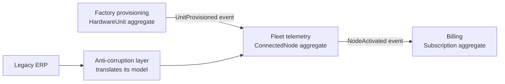
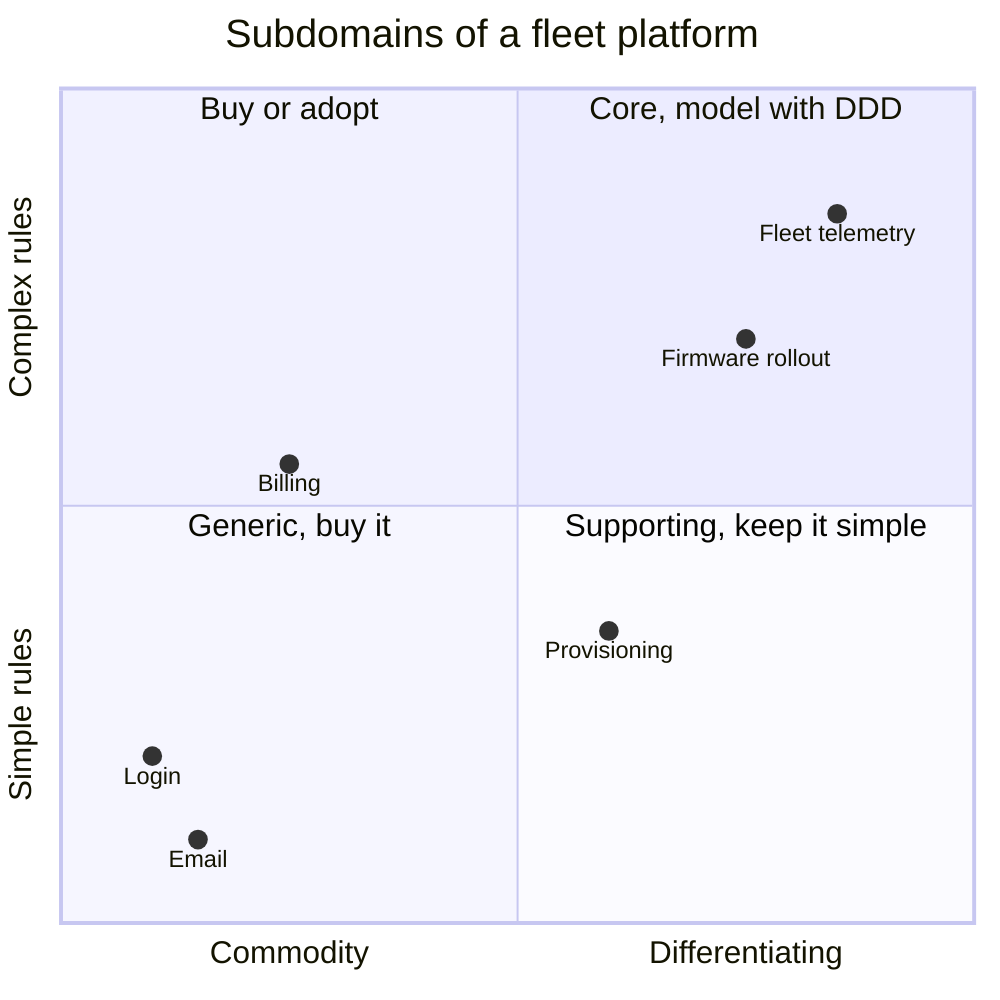

## Key figures {.stats style=tiles}

| Value | Label |
|---|---|
| 1 language | Spoken by the experts and written in the code |
| 1 meaning | For each term, inside a bounded context |
| 1 aggregate | Changed in each transaction |
| No ID | Value objects: equal when their values are equal, and never changed |

## Introduction {.abstract}

Large systems rarely fail because an algorithm is slow. They fail when one bloated `Device` class tries to serve billing, telemetry, manufacturing and support at once. Eric Evans's **Domain-Driven Design (DDD)** works at two levels. **Strategic design** splits the system into **bounded contexts**, guarded where needed by **anti-corruption layers**. **Tactical design** models the rules inside each with **entities**, **value objects**, **aggregates** and **domain events**.

## 1. One word, three meanings {.wide}

A single company-wide `Device` schema becomes a fragile monolith. The word means something different in each **bounded context**:

```cards cols=3 style=top
Manufacturing | A board serial number, a test log, a hardware revision and a certificate request. Billing plans mean nothing here | navy
Fleet telemetry | A live LwM2M or MQTT endpoint, with battery voltage, signal strength, firmware version and a stream of readings | teal
Billing | A subscription line on a customer account, with a data quota and an invoice cycle | blue
```

## 2. The context map



Contexts talk through **domain events**, or through an **anti-corruption layer** that keeps a legacy model from leaking in.

## 3. Where to invest

Not every part of a system deserves careful modelling. Plot each **subdomain**:



## 4. Four rules for aggregates

```steps
Protect rules inside one root | Outside code holds only the root; children change only through the root's methods
Keep them small | The root and only what its rules need: large aggregates contend for locks | teal
Refer to others by ID | Hold a RolloutId, never a pointer to another aggregate | blue
One aggregate per transaction | Others catch up through domain events, published with an outbox | green
```

## 5. The building blocks {.wide}

```compare
| Identity | Change | Examples
**Value object** | **Its values**: two 21.5 °C objects are equal | **Never changes**: operations return a new one | Temperature, Money, MacAddress, FirmwareVersion
**Entity** | **An ID** that lasts while its state changes | Changed through domain methods | SensorNode, MaintenanceTicket, Customer
**Aggregate** | Entities and values under **one root entity** | **Changed as one unit**, which keeps its rules true | RolloutCampaign and its target batches
**Domain event** | A fact that **has happened**, in the past tense | **Never changes** | OverheatThresholdBreached, RolloutCompleted
```

## 6. Anaemic or rich {.wide}

```code-compare
@bad An anaemic model: anyone can set anything
device.set_status(STATUS_OTA_ACTIVE);          <1>
@good A rich aggregate root: the rule lives with the data
Result<OtaStarted, DomainError>
ConnectedNode::start_update(const FirmwareImage &img, Percent min_battery) {
    if (battery_ < min_battery)            return DomainError::BatteryTooLow;
    if (!img.fits(hardware_revision_))     return DomainError::WrongHardware;   <2>
    state_ = NodeState::Downloading(img.version());
    return OtaStarted{id_, img.version()};                                      <3>
}
-- 1 | Nothing checked the battery first
-- 2 | Every rule is checked in one place, in the language of the domain
-- 3 | The change is announced as an event, for other contexts
```

## 7. Checklist {cols=2 style=card colour=teal}

```checklist
[x] A living glossary of the ubiquitous language; rename code when the language changes
[x] A context map: every context, and whether it integrates by events or through an ACL
[x] Value objects instead of bare floats and ints: `Temperature::from_celsius(21.5)`
[x] No public setters on roots: only commands such as `approve()` and `abort_rollout()`
[x] Domain events published through an outbox table, in the same transaction
```

## 8. Glossary

```glossary cols=1
ACL | Anti-corruption layer
CQRS | Separate models for commands and queries
CRUD | Create, read, update, delete: enough for simple subdomains
Event sourcing | Storing an aggregate as its log of events
Outbox | A table written in the transaction, then published
Ubiquitous language | The shared words of experts and code
```

## In short {.summary}

Split big systems into bounded contexts with their own language, protect them with anti-corruption layers, and keep rules inside small aggregates built from value objects.

### Stop building one model

A `Device` shared by ten teams suits none of them.

### Make bad states impossible

Distinct types for temperature, voltage and node ID stop arguments being swapped.

### Tell, don't ask

Call a method on the aggregate, and let it guard its own rules.
