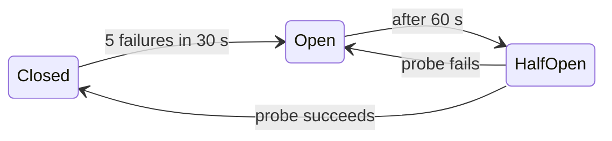

## Key figures {.stats style=tiles}

| Value | Label |
|---|---|
| 10,000 at once | Devices reconnecting in the same second, without jitter |
| 3 states | Of a circuit breaker: closed, open, half-open |
| 1 key | Per request makes a retry safe: the idempotency key |
| Bounded | Every queue, cache and retry loop |

## Introduction {.abstract}

Whether 50,000 sensors report to a broker or services call a database, networks drop packets, certificates expire and servers stall. Naive handling makes it worse: instant retries become **retry storms** that knock a recovering server down again, and unbounded queues run out of memory. Five patterns fix it: **timeouts**, **backoff with full jitter**, **idempotency keys**, **circuit breakers**, and **bounded store-and-forward**.

## 1. One outage, its threats and barriers

```bowtie
hazard: Fleet and broker
top: Broker down
threat: Retry storm | Jitter, Limits
threat: Cert expiry | Alerts, Renewal
threat: Poison message | DLQ
consequence: Data lost | Flash buffer, Replay
consequence: Battery drain | Breaker, Capped backoff
```

## 2. Backoff with full jitter

If 10,000 devices retry at 2, 4 and 8 seconds, they hit the server in synchronised waves. Random **full jitter** spreads them evenly:

```equation
title: Capped exponential backoff, full jitter
t_n = \mathrm{random}\left(0,\ \min(t_{\text{cap}},\ t_{\text{base}} \cdot 2^{n})\right)
t_n | Wait before retry n | ms
t_{\text{base}} | First wait, such as 1 s | ms
t_{\text{cap}} | Longest wait, such as 5 minutes | ms
```

```lanes
Fixed or plain exponential | *All 10,000 at 2 s | *All at 4 s | *All at 8 s | The server never recovers
Full jitter | *Spread over 0 to 2 s | *Spread over 0 to 4 s | *All back | No spikes
```

> [!WARNING]
> Seed the random generator from a hardware TRNG or the device ID. If every MCU boots with the same seed, they all pick the same "random" wait.

## 3. The circuit breaker {cols=3}

Waiting 30 seconds on a dead dependency for every request ties up threads and drains batteries. A breaker fails fast:



While open, calls fail in microseconds, and readings go to flash.

## 4. Retries need idempotency

Delivery is **at least once**: the server may act, then lose the acknowledgement, and the client retries.

```cards cols=1 style=top
Idempotent by nature | Set absolute state: `valve = 40 %` or `PUT /devices/42/config` can be repeated with the same result. Avoid relative deltas such as `+10 %` | green
Idempotent by key | Attach a key, such as a UUID or device ID with a sequence number. The server records keys it has processed, and replays its earlier answer instead of acting twice | amber
```

## 5. Store and forward

A flash ring buffer holds readings through an outage. The read pointer trails the write pointer; when full, routine logs overwrite the oldest, but a reserve for alarms is never overwritten.

```ring cells=16
fill: 0-4 | Acknowledged: free to reuse | green
fill: 5-11 | Waiting to send | amber
fill: 12-15 | Alarm reserve | red
pointer: 5 | Read | navy
pointer: 12 | Write | blue
```

## 6. Naive and resilient {.wide}

```compare
| Naive | Resilient
A dependency hangs | Calls block for ever; every worker freezes | **A deadline on every call**, and bulkhead pools
Offline for a day | Readings dropped, or memory grows until it runs out | **A bounded flash ring**, overwriting the oldest routine data
Producer faster than consumer | The queue grows until the crash | **Backpressure**: block, shed low-priority data, or reply 429
A poison message | Crash, restart, read it again, crash | **Dead-letter queue** after N failures
```

## 7. Checklist {style=card colour=amber}

```checklist
[x] A timeout on every socket, query and bus call
[x] Full jitter, seeded from a TRNG, on every retry and reconnect
[x] An idempotency key in every command and telemetry batch
[x] Every queue bounded, with a stated overflow policy: drop oldest, or push back
[x] Fault injection in CI: drop 20 % of packets, delay ACKs, kill the broker mid-transfer
```

## 8. Glossary

```glossary cols=1
DLQ | Dead-letter queue
Idempotent | Safe to repeat: the same result every time
MTTR | Mean time to recovery
OOM | Out of memory
TRNG | True random number generator
UUID | Universally unique identifier
```

## In short {.summary}

Assume every call will time out. Bound every wait, spread retries with jitter, make them safe with idempotency keys, and buffer offline data in a bounded ring.

### Never retry without jitter

Synchronised retries turn a five-second blip into a denial-of-service attack on yourself.

### If you retry, be idempotent

A timeout may mean the request failed, or that the reply was lost.

### Bound every queue

An unbounded queue is an out-of-memory crash, postponed.
