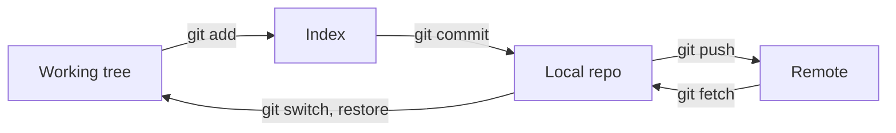
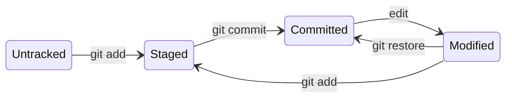
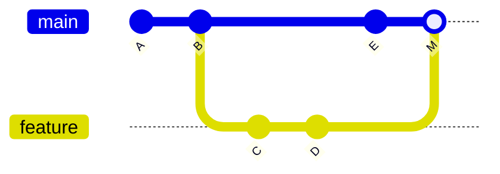

## Key figures {.stats style=tiles}

| Value | Label |
|---|---|
| 4 zones | Working tree, staging index, local and remote repository |
| 40 hex characters | The SHA-1 hash that names every commit |
| 3 object types | Blob, tree and commit |
| 41 bytes | A branch, on disk: one hash and a newline |

## Introduction {.abstract}

**Git** is the distributed version control system Linus Torvalds wrote in 2005. Instead of storing line differences on one server, it records **snapshots** of the whole project, named by their hashes, in a local `.git` folder. Every clone has the full history, so committing, branching, reading the log and switching happen in milliseconds, with no network.

## 1. Four zones

```cards cols=2 style=top
Working tree | The files on your disk, where you edit and build | amber
Staging index | The draft of the next commit, in .git/index | blue
Local repository | Your copy of every commit and branch, in .git/objects | navy
Remote repository | The shared one, on GitHub, GitLab or Gitea | green
```



## 2. Snapshots, not diffs

Each commit stores immutable objects in a **directed acyclic graph**. An unchanged file is not stored again: the new tree points at the same blob.

```cards cols=1 style=label
Blob | The compressed bytes of one file, named by its hash, with no file name
Tree | A folder: names and permissions mapped to blobs and subtrees
Commit | One root tree, its parent commits, the author, the time and the message
```

| Pointer | Points to |
|---|---|
| Branch, such as `main` | The latest commit of a line of work; it moves |
| `HEAD` | The branch or commit checked out now |
| Tag, such as `v1.2.0` | One release commit; it never moves |

## 3. The states of a file



```terminal title="What changed"
$ git status -sb
M  src/driver.c
 M src/main.c
?? tests/test_sensor.py
-- Left column: staged. Right column: modified, not staged. ??: untracked
```

## 4. Merge or rebase {.wide}



```compare
| git merge | git rebase
How | A new merge commit, with two parents | Replays your commits, one by one, on the target's tip
History | A graph that keeps when branches really diverged | A straight line, with no merge commits
Hashes | Kept | **Rewritten**: new commits
The rule | Safe on shared branches such as main | **Only on your own branches**, never on shared history
```

> [!WARNING]
> Never rebase commits others have pulled. Rebasing makes new commits, and leaves teammates with two copies of the same work.

## 5. From idea to pull request {.wide}

```steps cols=3
Start from main | `git switch main` and `git pull`
Branch | `git switch -c feat/sensor-driver` | blue
Edit and stage | Change, test, and stage in logical pieces: `git add -p`
Commit | `git commit -m "feat: add I2C temperature driver"` | navy
Push | `git push -u origin feat/sensor-driver` | green
Open a pull request | CI runs the tests; teammates review the diff
```

## 6. Commands worth knowing

| Task | Command |
|---|---|
| Start, or copy | `git init`, `git clone <url>` |
| Look | `git status`, `git log --oneline --graph --all` |
| Put work aside | `git stash`, `git stash pop` |
| Undo a pushed commit | `git revert <commit>`: a new commit that reverses it |
| Unstage, or discard | `git restore --staged <f>`, `git restore <f>` |
| Fetch, or fetch and merge | `git fetch`; `git pull` is fetch then merge (or rebase) |

## 7. Before you push {style=card colour=navy}

```checklist
[x] Each commit does one thing and builds on its own
[x] Each message says why, not only what
[x] No secrets, binaries or logs staged
[x] Up to date with main, and CI green
```

## 8. Glossary

```glossary cols=1
DAG | Directed acyclic graph: commits point to their parents
DVCS | Distributed version control system
HEAD | What is checked out now
PR, MR | Pull request, merge request
SHA | Secure hash algorithm: Git's object names
```

## In short {.summary style=line}

Git keeps your work safe as snapshots: stage on purpose, commit small logical steps, and branch for every feature.

### Stage with purpose

The index lets you commit a clean change while experiments stay in the working tree.

### Branch for everything

A branch is a 41-byte file: creating and switching take milliseconds.

### History is a safety net

Once committed, a snapshot can always be found, restored or reverted.
