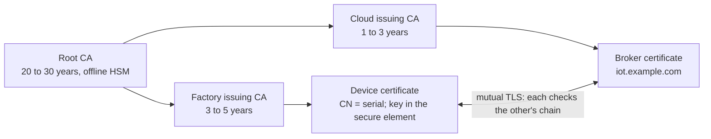
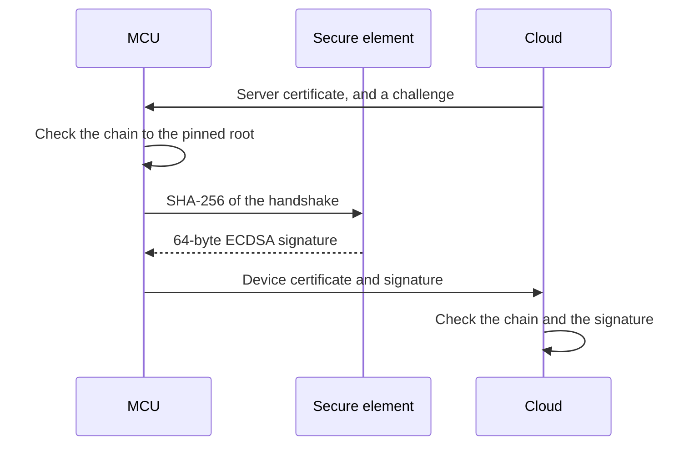

## Key figures {.stats style=tiles}

| Value | Label |
|---|---|
| 3 tiers | Root CA, issuing CA and device certificate |
| 64 bytes | An ECDSA P-256 or Ed25519 signature; RSA-2048's is 256 |
| 0 | Times a secure element's private key leaves the chip |
| 1 device | Affected when one certificate is revoked |

## Introduction {.abstract}

How does the cloud know a connecting sensor came off your production line, and is not an attacker using its serial number? A password or **pre-shared key** shared across a fleet means one stolen unit's flash compromises them all. **Public key infrastructure (PKI)** gives each device its own **key pair**, held in a **secure element** or **TPM**, and an **X.509 certificate** signed by your **certificate authority (CA)**.

## 1. Three tiers of trust

Never sign devices with the root. Keep the root key offline in a vault, and let an issuing CA sign day to day:



## 2. Inside an X.509 certificate

A certificate (RFC 5280) binds a **subject**, such as serial SN-0049182, to its **public key**, signed by the **issuer**. With an elliptic-curve key it is about 350 to 500 bytes in DER.

```stack
Version, serial, validity | metadata | Not before, not after | navy
Issuer and subject | names | The factory CA; the device's serial | blue
Public key | EC P-256 | 65 bytes | green
Extensions | v3 | Key usage; basic constraints: not a CA | amber
Signature | ECDSA-SHA256 | 64 bytes, by the issuer | red
side: Signed by the issuer | 1-4 | red
```

> [!TIP]
> Store certificates on microcontrollers as binary **DER**, not Base64 **PEM**: a quarter smaller, and nothing to decode.

## 3. Where the private key lives {.wide}

The certificate is public. The private key must survive a debug probe, and a decapping lab:

```compare
| Plain MCU flash | TrustZone (TF-M) | Secure element (ATECC608, SE050) or TPM 2.0
Stored in | An ordinary flash sector | A secure flash partition | A tamper-resistant crypto chip on I2C or SPI
Debug-port dump | **Exposed** if readout protection is bypassed | Protected from non-secure software | **Never exposed**: only signatures leave the chip
Physical attacks | None: open to voltage glitching | Basic clock and voltage monitors | **Shields, glitch sensors, constant-time logic**
Provisioning | Generate and flash keys on your line | Generate on-chip at first boot | **Pre-provisioned** at the chip vendor
Added cost | None | None, in Cortex-M33 and M55 | About $0.35 to $1.20
```

## 4. Provisioning without seeing a key

```steps
Key generated on the chip | The secure element's TRNG makes a P-256 key pair in a locked slot; the private key cannot be exported
CSR signed by the chip | The fixture asks it for a certificate signing request with the public key and serial | blue
Certificate issued | The factory CA signs it and returns a DER certificate (or the chip came with one) | amber
Locked and registered | The certificate is stored, the chip's configuration locked, and the device registered in the cloud | green
```

## 5. Proving it, in the handshake



```c
/* CryptoAuthLib: the key stays in the slot; only the signature comes back */
atcab_sign(SLOT_DEVICE_KEY, transcript_sha256, signature);
```

Dump every byte of the MCU's flash, and you still cannot impersonate the device.

## 6. Rotation and revocation {style=card colour=red}

```checklist
[x] Elliptic-curve keys, P-256 or Ed25519: certificates less than half the size of RSA-2048's
[x] The root CA offline; devices signed by an issuing CA
[x] The root, and a backup root, pinned in firmware, so issuing CAs can rotate without bricking devices
[x] A trusted clock, so certificate validity dates can be checked
[x] A registry blocklist, so a stolen device can be revoked at once
```

## 7. Glossary

```glossary cols=1
CA | Certificate authority
CRL, OCSP | Certificate revocation list; online status protocol
CSR | Certificate signing request, PKCS#10
DER, PEM | Binary ASN.1; its Base64 text form
HSM | Hardware security module, for CA keys
mTLS | Mutual TLS: both ends present certificates
SE, TPM | Secure element; trusted platform module
TF-M | Trusted Firmware-M, for TrustZone
```

## In short {.summary}

Give every device its own P-256 key, locked in a secure element or TrustZone, sign its certificate with an issuing CA, and connect with mutual TLS.

### Never share a fleet secret

One credential across ten thousand devices is broken by reverse-engineering one of them.

### Keep the key off the bus

When the secure element signs internally, the MCU's flash holds nothing worth stealing.

### Pin a backup root

A second, offline root key in the firmware is the way back when a CA must change.
