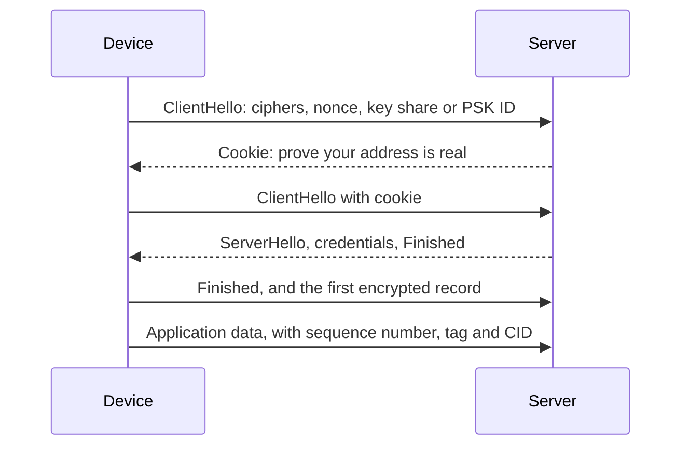

## Key figures {.stats style=tiles}

| Value | Label |
|---|---|
| 3 guarantees | Authentication, confidentiality, and integrity with replay protection |
| 0 extra packets | To resume after sleep, with a DTLS connection ID |
| About 150 B | A PSK handshake; certificate chains take 2 to 4 KB |
| 8 or 16 bytes | The AES-CCM authentication tag |

## Introduction {.abstract}

Unprotected IoT traffic can be read, replayed or changed. **TLS** secures TCP streams such as MQTT and HTTPS. **DTLS** gives the same guarantees to UDP datagrams, such as CoAP and LwM2M, which may be lost or arrive out of order. The right credentials and resumption keep devices secure without draining their batteries.

## 1. Three guarantees {.wide}

```cards cols=3 style=top
Authentication: who are you? | Proves the server's and the device's identity, with a pre-shared key, a raw public key or an X.509 certificate | navy
Confidentiality: who can read it? | Encrypts every record with a symmetric cipher such as AES, so a listener sees noise | blue
Integrity: was it changed? | A tag and a sequence number on every record, so altered or replayed packets are rejected | green
```

## 2. The handshake



DTLS adds the **cookie** round trip, so a spoofed UDP address cannot make the server do expensive cryptography.

## 3. A DTLS record, byte by byte

TLS assumes a reliable stream: lose a packet and its implicit sequence count breaks. DTLS puts the epoch and sequence number in every record:

```hex-dissect cols=8 title="DTLS 1.2 record with a connection ID" ascii=no
bytes: 19 fe fd 00 01 00 00 00 00 00 2a 8f 2a 91 04 00 1d 7e 31 c4 0a 92 5b e8 13
0 | Content type | 25: application data with a CID | navy
1-2 | Version | DTLS 1.2 | grey
3-4 | Epoch | 1: the first keys | blue
5-10 | Sequence number | 42 | blue
11-14 | Connection ID | 0x8F2A9104 | green
15-16 | Length | 29 bytes follow | grey
17-24 | Encrypted CoAP and its tag | First 8 of 29 bytes | amber
```

## 4. Three ways to reconnect

```lanes
Full handshake | *ClientHello and cookie | *ServerHello, certificates | *Key exchange | *Data: 6 to 10 packets
Session resumption | *ClientHello with session ID | *ServerHello, Finished | *Data: 3 packets
Connection ID | *Wake from PSM | *Encrypted CoAP with the CID: 1 packet | *Reply: no handshake
```

## 5. Credentials {.wide}

```compare
| Pre-shared key (PSK) | Raw public key (RPK, RFC 7250) | X.509 certificate chain
Cryptography | A shared symmetric secret | An elliptic-curve key pair | A key pair and a CA's signature
Handshake | **About 150 bytes** | **About 350 bytes** | **1,500 to 4,000 bytes and more**
Time on an MCU | Under 5 ms | 50 to 200 ms | 100 to 400 ms
Provisioning | A unique secret per device | Each public key registered | Scales to millions through the CA
```


## 6. Waking through NAT

An NB-IoT device sleeping a day in PSM loses its NAT mapping: it comes back on a new port. Without a CID the server cannot find the session, and the handshake starts again. **RFC 9146** puts a short connection ID in each record, so the session survives any change of address.

```terminal title="A modem waking, with a CID"
> AT+QSSLCFG="ciphersuite",0,0xC0A8
OK
-- 0xC0A8: TLS_PSK_WITH_AES_128_CCM_8
-- Record: epoch 1, sequence 42, CID 0x8F2A9104: session found
-- Decrypted: CON POST /3303/0/5700, 21.4 °C
```

> [!WARNING]
> Never share one PSK across a fleet. Give each device its own, or an ECDSA key in a secure element.

## 7. Cipher suites {style=card colour=navy}

AEAD suites, from the IANA registry:

| Suite | Key exchange | Tag | For |
|---|---|---|---|
| TLS_PSK_WITH_AES_128_CCM_8 | PSK | 8 B | The smallest CoAP and LwM2M over NB-IoT |
| TLS_ECDHE_PSK_WITH_AES_128_GCM_SHA256 | ECDHE with PSK | 16 B | **Forward secrecy** with PSKs |
| TLS_ECDHE_ECDSA_WITH_AES_128_CCM | ECDHE with ECDSA | 16 B | Raw-public-key or X.509 fleets |

```checklist
[x] A hardware TRNG seeds the entropy pool at boot
[x] A unique PSK or ECDSA key per device, set at the factory
[x] Connection IDs (RFC 9146) on, at both ends
[x] The server's certificate or PSK identity checked strictly
```

## 8. Glossary {.wide}

```glossary cols=3
AEAD | Authenticated encryption with associated data
CID | DTLS connection ID, RFC 9146
ECDHE | Ephemeral elliptic-curve Diffie-Hellman
NAT | Network address translation
OSCORE | CoAP-level encryption, RFC 8613
PSK, RPK | Pre-shared key; raw public key
```

## In short {.summary}

TLS for TCP, DTLS with connection IDs for UDP, hardware AES, and unique credentials per device: every message private, authentic and replay-proof.

### A key per device

One compromised device must never endanger the fleet.

### Resume with a connection ID

A waking NB-IoT device sends its reading in one packet, with no handshake.

### Use the crypto hardware

On-chip AES, SHA-256 and TRNG cut handshake time and energy by an order of magnitude.

## References {.references}

1. IETF RFC 9147, *The Datagram Transport Layer Security (DTLS) Protocol Version 1.3*, 2022.
2. IETF RFC 9146, *Connection Identifier for DTLS 1.2*, 2022; RFC 7925, *TLS/DTLS Profiles for the Internet of Things*.
