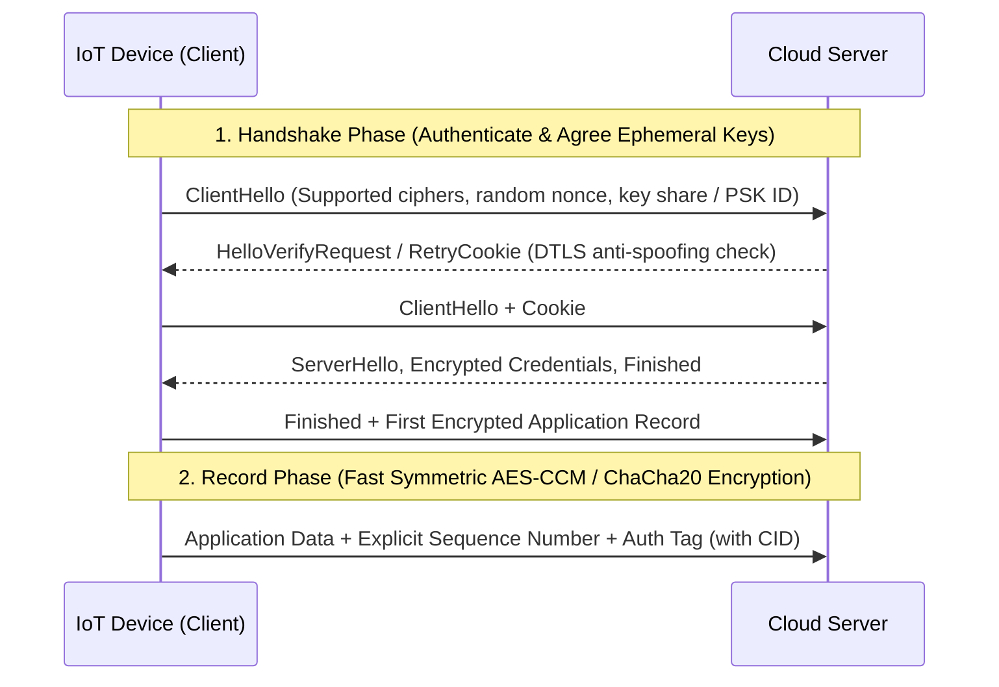

## Key figures {.stats style=tiles}

| Value | Label | Change | Verdict |
|---|---|---|---|
| 3 pillars | Confidentiality, Integrity via Message Authentication Code (MAC) and Auth | end-to-end | good |
| 0 extra pkts | Wakeup overhead using a Connection Identifier (CID) | -90 % air time | good |
| ~150 B | Pre-Shared Key (PSK) handshake size vs 2–4 KB for X.509 certificate chains | fits NB-IoT | good |
| 16 bytes | Advanced Encryption Standard (AES) authentication tag size | hardware crypto | good |

## Introduction {.abstract}

Attackers can intercept, replay or alter unprotected **Internet of Things (IoT)** radio traffic. **Transport Layer Security (TLS)** secures **Transmission Control Protocol (TCP)** streams (such as **MQTT** and **HTTPS**). **Datagram Transport Layer Security (DTLS)** adapts the same cryptographic guarantees for connectionless **User Datagram Protocol (UDP)** packets (such as **CoAP** and **LwM2M**) that may drop or arrive out of order. Picking the right credential mode and session resumption strategy protects devices without draining their batteries.

## 1. What TLS and DTLS protect: the three security pillars {.wide}

A secure channel solves three distinct threats during the handshake and record phase:

```cards cols=3 style=top
1. Authentication (Who are you?) | Proves the identity of the server and the device using Pre-Shared Keys (PSK), Raw Public Keys (RPK) or X.509 certificates so impostors cannot join | navy
2. Confidentiality (Who can read it?) | Encrypts every payload using a symmetric cipher such as Advanced Encryption Standard (AES) so eavesdroppers see only random bytes | blue
3. Integrity & Anti-Replay (Was it altered?) | Appends a cryptographic Message Authentication Code (MAC) and sequence number so modified or replayed packets are rejected immediately | green
```



[[CAPTION:Figure]] DTLS adds a stateless cookie exchange to block spoofed UDP source addresses before running cryptographic operations.

## 2. Why UDP needs DTLS instead of plain TLS {cols=2}

Standard **TLS** assumes a reliable **TCP** byte stream: if a packet drops or arrives out of order, TLS decryption breaks because its implicit sequence counter desynchronises. **DTLS** modifies the record layer to tolerate lossy radio links:

```figure
@segments
title: DTLS 1.2 / 1.3 encrypted UDP record structure
2 | Type & Ver (3 B) | header | navy
2 | Epoch & Seq (8 B) | explicit | blue
2 | CID (4–8 B) | session | green
5 | Encrypted CoAP Payload | N bytes | amber
2 | Auth Tag (8–16 B) | MAC | teal
+++
@lanes
Full Handshake | *ClientHello + Cookie | *ServerHello + Certs | *Key Exchange | *Encrypted Data (6–10 pkts)
Session Resume | *ClientHello (Session ID) | *ServerHello + Finished | *Encrypted Data (3 pkts)
Connection ID (CID) | *Wake from PSM sleep | *Send Encrypted CoAP + CID (1 pkt) | *Server replies (0 handshake pkts!)
```

## 3. Credential modes: PSK vs Raw Public Key vs X.509

Constrained devices choose between three ways to prove their identity during the handshake:

```compare
| Pre-Shared Key (PSK) | Raw Public Key (RPK) | X.509 Certificate Chain
Crypto type | Symmetric shared secret | Asymmetric Elliptic Curve | Asymmetric + Certificate Authority (CA)
Handshake size | **~150 bytes** (smallest) | **~350 bytes** (key only) | **1,500 to 4,000+ bytes**
MCU compute | < 5 ms | 50 to 200 ms | 100 to 400 ms
Provisioning | Unique secret key per node | Pre-register public key hash | Scales to millions via CA trust
```

```chart type=bar title="Handshake bytes transmitted over the air by credential mode" unit=" B" max=3200
DTLS CID Resume | 12
PSK Handshake | 180
Raw Public Key | 420
X.509 (2-cert) | 2850
```

## 4. Saving battery: connection identifiers over cellular

When an **NB-IoT** device sleeps in **Power Saving Mode (PSM)** for 24 hours, the mobile network's **Network Address Translation (NAT)** router forgets the device's UDP source port. **Internet Engineering Task Force (IETF)** **Request For Comments (RFC)** 9146 defines the **Connection Identifier (CID)** to keep the session alive across NAT rebindings:

```cards cols=2 style=top
Without CID | Server looks up the session by `(Source IP, Source Port)`. After PSM sleep, NAT assigns a new port, breaking the DTLS session and forcing a 6-packet handshake | amber
With CID (RFC 9146) | Both peers include a short plaintext `CID` tag in the DTLS header. Even when the IP and port change after sleep, the server finds the session keys in 0 extra packets | green
```

```lcd cols=1
AT+QSSLCFG="ciphersuite",0,0xC0A8  (TLS_PSK_WITH_AES_128_CCM_8)
DTLS Record: Epoch=1 Seq=42 CID=0x8F2A9104 (Matched session!)
Decrypted: CON POST /3303/0/5700 (21.4 C)
-- Zero-handshake wakeup using RFC 9146 Connection Identifier
```

> [!WARNING]
> Never share the same global **Pre-Shared Key (PSK)** across a fleet of devices. Provision a unique per-device PSK or use **Elliptic Curve Digital Signature Algorithm (ECDSA)** keys in a secure element.

## 5. Selecting a cipher suite and security checklist {style=card colour=navy}

Modern IoT deployments use **Authenticated Encryption with Associated Data (AEAD)** ciphers listed by the **Internet Assigned Numbers Authority (IANA)**:

| Cipher Suite Name | Key Exchange & Auth | Encryption | Best For |
|---|---|---|---|
| `TLS_PSK_WITH_AES_128_CCM_8` | Pre-Shared Key (`PSK`) | `AES-128` (8-B tag) | Ultra-compact CoAP / LwM2M over NB-IoT |
| `TLS_ECDHE_PSK_WITH_AES_128_GCM_SHA256` | Ephemeral Diffie-Hellman + `PSK` | `AES-128` (16-B tag) | Adds **Forward Secrecy** for past captures |
| `TLS_ECDHE_ECDSA_WITH_AES_128_CCM` | Ephemeral Diffie-Hellman + `ECDSA` | `AES-128` (16-B tag) | X.509 or Raw Public Key fleets |

```checklist
[x] Hardware True Random Number Generator (TRNG) seeds the TLS/DTLS entropy pool at boot
[x] Unique per-device PSK or ECDSA private key injected at factory provisioning
[x] DTLS Connection Identifier (RFC 9146) enabled on both client and server
[x] Server certificate or PSK identity verified strictly to block Man-In-The-Middle (MITM) relays
```

## 6. Acronym guide: every term defined {.wide}

```cards cols=4 style=label
TLS / DTLS | Transport Layer Security (over TCP) and Datagram Transport Layer Security (over connectionless UDP)
PSK / RPK | Pre-Shared Key (symmetric secret) and Raw Public Key (certificate-free asymmetric public key, RFC 7250)
CID | Connection Identifier (RFC 9146): session tag inside the DTLS record header that survives NAT IP/port changes
AEAD & MAC | Authenticated Encryption with Associated Data and Message Authentication Code (tamper-proof tag)
AES-CCM / GCM | Advanced Encryption Standard in Counter with CBC-MAC mode or Galois/Counter Mode
ECDSA / ECDHE | Elliptic Curve Digital Signature Algorithm and Elliptic Curve Diffie-Hellman Ephemeral key exchange
CA & X.509 | Certificate Authority (trusted signer) and X.509 standard format for public-key identity certificates
MITM & RTT | Man-In-The-Middle interception attack and Round-Trip Time (network latency for one request and reply)
TRNG & HSM | True Random Number Generator (hardware entropy source) and Hardware Security Module (secure key element)
NAT & PSM | Network Address Translation (router port mapping) and Power Saving Mode (deep cellular sleep)
OSCORE | Object Security for Constrained RESTful Environments: application-layer CoAP encryption (RFC 8613)
IANA & IETF | Internet Assigned Numbers Authority (cipher registry) and Internet Engineering Task Force
```

## In short {.summary}

Use `TLS` for `TCP` streams and `DTLS` with **Connection Identifier (`CID`)** for `UDP` packets: pair hardware-accelerated `AES` with unique per-device credentials so every message is private, authentic and replay-proof.

### Unique keys per device

Provision a unique PSK or ECDSA key pair into each unit on the factory line so a compromised node never endangers the fleet.

### Resume with connection identifiers

`RFC 9146` Connection Identifiers let waking NB-IoT devices send encrypted telemetry in a single packet without repeating the handshake.

### Hardware crypto saves milliwatts

On-chip `AES`, `SHA-256` and `TRNG` peripherals cut handshake time and energy consumption by an order of magnitude.

## References {.references}

1. Internet Engineering Task Force (IETF) Request For Comments (RFC) 9147, *The Datagram Transport Layer Security (DTLS) Protocol Version 1.3*, 2022.
2. IETF RFC 9146, *Connection Identifier for DTLS 1.2*, 2022, and RFC 7925, *TLS / DTLS Profiles for the Internet of Things*.
